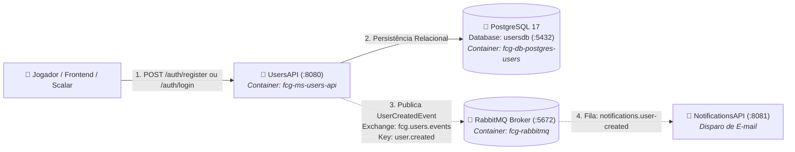

# FIAP Cloud Games - Fase 02 - Microsserviço UsersAPI (`fcg-fase-02--users`)

[](https://dotnet.microsoft.com/)
[](https://www.postgresql.org/)
[](https://www.rabbitmq.com/)
[](https://www.docker.com/)

> 🎓 **Projeto Acadêmico FIAP**  
> Este microsserviço faz parte do projeto de conclusão de curso da **"Pós-Tech: Arquitetura de Sistemas .NET"** da **FIAP**.  
> O objetivo da solução é projetar e implementar um ecossistema distribuído de nuvem voltado para uma plataforma de jogos digitais (*Cloud Gaming*), aplicando os mais modernos padrões de arquitetura corporativa em **.NET 10**.

---

> 🌐 **Documentação Principal e Orquestração do Ecossistema:**  
> A visão geral de toda a solução distribuída, a topologia de pastas, a arquitetura de redes e o guia para inicialização unificada de todos os microsserviços e bancos de dados estão centralizadas no repositório de **Orquestração**:  
> 👉 **[🚀 Acessar Ponto de Partida & Orquestração (`fcg-fase-02--orchestration`)](../fcg-fase-02--orchestration/README.md)** | [Repositório GitHub](https://github.com/idgrego/fcg-fase-02--orchestration)

---

## 📑 Sumário

- [1. O Microsserviço UsersAPI](#1-o-microsserviço-usersapi)
  - [1.1. Responsabilidades de Negócio](#11-responsabilidades-de-negócio)
  - [1.2. Papéis de Acesso (RBAC)](#12-papéis-de-acesso-rbac)
  - [1.3. Diagrama de Integração](#13-diagrama-de-integração)
- [2. Tecnologias & Decisões Arquiteturais](#2-tecnologias--decisões-arquiteturais)
- [3. Como Executar a UsersAPI](#3-como-executar-a-usersapi)
  - [3.1. Execução Integrada via Docker Compose (Recomendado)](#31-execução-integrada-via-docker-compose-recomendado)
  - [3.2. Execução Individual (.NET CLI & Docker Local)](#32-execução-individual-net-cli--docker-local)
- [4. Endpoints HTTP & Documentação Interativa (Scalar)](#4-endpoints-http--documentação-interativa-scalar)
- [5. Mensageria Assíncrona & Eventos Publicados](#5-mensageria-assíncrona--eventos-publicados)
- [6. Testes Unitários](#6-testes-unitários)
- [7. Documentação Técnica Detalhada (`/docs`)](#7-documentação-técnica-detalhada-docs)

---

## 1. O Microsserviço UsersAPI

A **UsersAPI** é o serviço responsável pelo gerenciamento de identidade, autenticação e autorização centralizada de todo o ecossistema **FIAP Cloud Games**.

### 1.1. Responsabilidades de Negócio
- **Cadastro de Usuários:** Criação de contas de jogadores e administradores com validação de formato de e-mail e hash criptográfico adaptativo com BCrypt.
- **Autenticação & Emissão de Tokens JWT:** Emissão de tokens JWT Bearer assinados, contendo claims de identidade (`NameIdentifier`, `Name`, `Email`, `Role`).
- **Validação de Credenciais:** Endpoint seguro de consulta do próprio perfil do usuário autenticado (`GET /api/v1/users/me`).
- **Publicação de Eventos Transacionais:** Emissão do evento assíncrono `UserCreatedEvent` na exchange do RabbitMQ para que o microsserviço de notificações envie o e-mail de boas-vindas.

### 1.2. Papéis de Acesso (RBAC)
O microsserviço implementa controle de acesso baseado em funções (*Role-Based Access Control*):
- **`Anonymous`:** Visitante da plataforma sem credenciais ativas.
- **`Gamer`:** Jogador autenticado com permissão para gerenciar sua biblioteca e comprar jogos na `CatalogAPI`.
- **`Admin`:** Administrador com privilégios de gestão de catálogo e governança.

### 1.3. Diagrama de Integração



---

## 2. Tecnologias & Decisões Arquiteturais

- **Runtime & Plataforma:** .NET 10 (`net10.0`), C# 14, Solution moderna no formato `.slnx`.
- **Clean Architecture:** Separação estrita em 4 camadas desacopladas:
  - `FCG02.UsersAPI.Domain`: Entidades de negócio ricas, enums, contratos de repositório e Value Object `Email` com Expressão Regular pré-compilada (`RegexOptions.Compiled`).
  - `FCG02.UsersAPI.Application`: Casos de uso (`UserService`, `AuthService`, `JwtTokenService`), DTOs e validações.
  - `FCG02.UsersAPI.Infrastructure`: Provedor relacional PostgreSQL via Entity Framework Core (`Npgsql.EntityFrameworkCore.PostgreSQL`), mapeamento via Fluent API, migrações e mensageria RabbitMQ 7.x.
  - `FCG02.UsersAPI.API`: Endpoints HTTP construídos com **Minimal APIs modulares**, OpenAPI nativo e documentação interativa com Scalar.
- **Segurança:** Hashing de senhas com algoritmo BCrypt com salt dinâmico (`BCrypt.Net-Next`) e tokens stateless HMAC-SHA256.
- **Containerização Segura:** Dockerfile Multi-stage com execução não-root nativa do .NET 10 (`USER app`).

---

## 3. Como Executar a UsersAPI

### 3.1. Execução Integrada via Docker Compose (Recomendado)

A forma recomendada de executar a UsersAPI é através da orquestração unificada, que sobe todo o ecossistema com um único comando:

1. Navegue até a pasta de orquestração:
   ```powershell
   cd ../fcg-fase-02--orchestration
   ```

2. Inicialize todos os contêineres:
   ```powershell
   docker compose up -d --build
   ```

3. Verifique o status dos serviços:
   ```powershell
   docker compose ps
   ```

4. Acompanhe os logs da UsersAPI:
   ```powershell
   docker compose logs -f users-api
   ```

---

### 3.2. Execução Individual (.NET CLI & Docker Local)

Caso queira executar a **UsersAPI** diretamente via `.NET CLI` para depuração ou desenvolvimento:

1. **Subir os contêineres de infraestrutura (PostgreSQL e RabbitMQ):**
   ```powershell
   # PostgreSQL para Users
   docker run -d --name pg-users -e POSTGRES_USER=postgres -e POSTGRES_PASSWORD=postgres -e POSTGRES_DB=usersdb -p 5432:5432 postgres:17-alpine

   # RabbitMQ com Management UI
   docker run -d --name rabbitmq -e RABBITMQ_DEFAULT_USER=guest -e RABBITMQ_DEFAULT_PASS=guest -p 5672:5672 -p 15672:15672 rabbitmq:3-management
   ```

2. **Aplicar as migrações no banco de dados:**
   Na pasta `fcg-fase-02--users`:
   ```powershell
   dotnet ef database update --project src/FCG02.UsersAPI.Infrastructure --startup-project src/FCG02.UsersAPI.API
   ```

3. **Executar a API via .NET CLI:**
   ```powershell
   dotnet run --project src/FCG02.UsersAPI.API
   ```

A API estará acessível em `http://localhost:5000` (ou na porta HTTP informada no terminal).

---

## 4. Endpoints HTTP & Documentação Interativa (Scalar)

Com o serviço em execução, acesse a interface interativa do **Scalar**:

👉 **URL do Scalar:** `http://localhost:8080/scalar/v1` (no Docker) ou `http://localhost:PORTA/scalar/v1` (local).

### Principais Endpoints:

| Método | Rota | Descrição | Autenticação |
|---|---|---|---|
| `POST` | `/api/v1/auth/register` | Cria uma nova conta e publica o evento `UserCreatedEvent` | Pública |
| `POST` | `/api/v1/auth/login` | Autentica com e-mail/senha e emite o Bearer Token JWT | Pública |
| `GET` | `/api/v1/users/me` | Retorna o perfil completo do usuário logado | Bearer JWT |
| `GET` | `/health` | Endpoint de verificação de integridade do serviço | Pública |

---

## 5. Mensageria Assíncrona & Eventos Publicados

Ao cadastrar um novo usuário (`POST /api/v1/auth/register`), a **UsersAPI** publica o evento **`UserCreatedEvent`**:

- **Exchange:** `fcg.users.events` (Tipo: `Topic`, `durable: true`)
- **Routing Key:** `user.created`
- **Fila Destino:** `notifications.user-created` (consumida pela `NotificationsAPI`)

### Payload Publicado (`UserCreatedEvent`):
```json
{
  "eventId": "a1b2c3d4-e5f6-7a8b-9c0d-1e2f3a4b5c6d",
  "occurredOn": "2026-10-29T10:00:00Z",
  "userId": "550e8400-e29b-41d4-a716-446655440000",
  "name": "Bruce Wayne",
  "email": "bruce.wayne@waynecorp.com",
  "role": "Gamer",
  "createdAt": "2026-10-29T10:00:00Z"
}
```

---

## 6. Testes Unitários

A **UsersAPI** possui suíte completa de testes unitários desenvolvida com **xUnit**, **Moq** e **FluentAssertions**, cobrindo regras de domínio e fluxos de aplicação:

- **Domínio:** Invariantes de entidade, mutações protegidas e validações exaustivas do Value Object `Email` (testes parametrizados com `[Theory]` e `[InlineData]`).
- **Aplicação:** Casos de uso `UserService` e `AuthService` com isolamento completo de persistência e tokenização via mocks.

Para executar todos os testes da solução:

```powershell
dotnet test tests/FCG02.UsersAPI.UnitTests/FCG02.UsersAPI.UnitTests.csproj --logger "console;verbosity=detailed"
```

---

## 7. Documentação Técnica Detalhada (`/docs`)

Para um aprofundamento específico em cada camada arquitetural da UsersAPI, consulte os documentos na pasta [`/docs`](docs/index.md):

- **[📑 Índice da Documentação Técnica da UsersAPI](docs/index.md)**
- **[🏛️ Arquitetura e Decisões de Design](docs/architecture.md)**
- **[🧩 Camada de Domínio & DDD](docs/domain.md)**
- **[⚙️ Camada de Aplicação, DTOs e Casos de Uso](docs/application.md)**
- **[🐘 Camada de Infraestrutura, EF Core e RabbitMQ](docs/infrastructure.md)**
- **[🚀 Camada de Apresentação, Minimal APIs e JWT](docs/api.md)**
- **[🧪 Suíte de Testes Unitários](docs/tests.md)**
- **[🐳 Containerização e Docker Multi-stage](docs/docker.md)**
