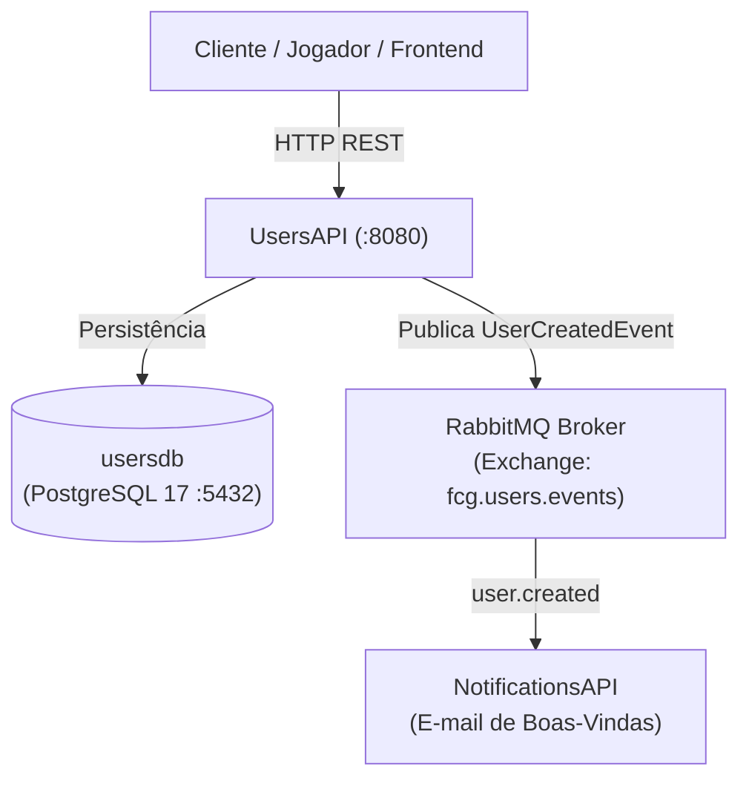

# FIAP Cloud Games - Fase 02 - Microsserviço UsersAPI (`fcg-fase-02--users`)

[](https://dotnet.microsoft.com/)
[](https://www.postgresql.org/)
[](https://www.rabbitmq.com/)
[](https://www.docker.com/)

> 🎓 **Projeto Acadêmico FIAP**  
> Este microsserviço faz parte do projeto de conclusão de curso da **"Pós-Tech: Arquitetura de Sistemas .NET"** da **FIAP**.  
> O objetivo da solução é projetar e implementar um ecossistema distribuído de nuvem voltado para uma plataforma de jogos digitais (*Cloud Gaming*), aplicando os mais modernos padrões de arquitetura corporativa em **.NET 10**.

---

## 📑 Sumário

- [1. Visão Geral da Fase 02](#1-visão-geral-da-fase-02)
  - [1.1. Os 5 Repositórios do Ecossistema](#11-os-5-repositórios-do-ecossistema)
  - [1.2. Topologia de Pastas Recomendada](#12-topologia-de-pastas-recomendada)
- [2. O Microsserviço UsersAPI](#2-o-microsserviço-usersapi)
  - [2.1. Responsabilidades e Funcionalidades](#21-responsabilidades-e-funcionalidades)
  - [2.2. Tecnologias e Padrões Arquiteturais](#22-tecnologias-e-padrões-arquiteturais)
- [3. Como Executar o Ecossistema Localmente](#3-como-executar-o-ecossistema-localmente)
  - [3.1. Pré-requisitos](#31-pré-requisitos)
  - [3.2. Execução Unificada via Docker Compose (Recomendado)](#32-execução-unificada-via-docker-compose-recomendado)
  - [3.3. Execução Individual da UsersAPI (.NET CLI)](#33-execução-individual-da-usersapi-net-cli)
- [4. Testes Unitários](#4-testes-unitários)
- [5. Documentação Interativa da API (Scalar / OpenAPI)](#5-documentação-interativa-da-api-scalar--openapi)
- [6. Documentação Técnica Detalhada (`/docs`)](#6-documentação-técnica-detalhada-docs)

---

## 1. Visão Geral da Fase 02

A Fase 02 do projeto **FIAP Cloud Games** é orientada a microsserviços desacoplados e distribuídos com **Database-per-Service** e comunicação assíncrona orientada a eventos (**Event-Driven Architecture - EDA**) através do **RabbitMQ**.

### 1.1. Os 5 Repositórios do Ecossistema

O ecossistema é composto por **5 repositórios Git independentes**:

| Repositório | Descrição | Link do Repositório |
|---|---|---|
| **`fcg-fase-02--users`** | **UsersAPI (Este repositório):** Microsserviço de gestão de identidade, usuários, emissão de tokens JWT e controle de papéis (`Anonymous`, `Gamer`, `Admin`). | [github.com/idgrego/fcg-fase-02--users](https://github.com/idgrego/fcg-fase-02--users) |
| **`fcg-fase-02--catalog`** | **CatalogAPI:** Gestão do catálogo de jogos, biblioteca do jogador, controle de compras e consumo de confirmações de pagamento. | [github.com/idgrego/fcg-fase-02--catalog](https://github.com/idgrego/fcg-fase-02--catalog) |
| **`fcg-fase-02--payments`** | **PaymentsAPI:** Simulador de gateway financeiro de pagamentos, validação de transações e emissão de eventos de resultado. | [github.com/idgrego/fcg-fase-02--payments](https://github.com/idgrego/fcg-fase-02--payments) |
| **`fcg-fase-02--notifications`** | **NotificationsAPI:** Central assíncrona de envio de e-mails transacionais (boas-vindas, confirmação de compra e falhas). | [github.com/idgrego/fcg-fase-02--notifications](https://github.com/idgrego/fcg-fase-02--notifications) |
| **`fcg-fase-02--orchestration`** | **Orquestração Local:** Docker Compose unificado com toda a infraestrutura (PostgreSQL, RabbitMQ) e integração dos microsserviços. | [github.com/idgrego/fcg-fase-02--orchestration](https://github.com/idgrego/fcg-fase-02--orchestration) |

### 1.2. Topologia de Pastas Recomendada

Para que os scripts de orquestração local (`docker-compose.yml`), caminhos relativos de build e redes funcionem de forma automática, **todos os 5 repositórios devem ser clonados lado a lado no mesmo diretório pai**:

```text
meu-diretorio-de-projetos/
├── fcg-fase-02--users/             # Repositório da UsersAPI
├── fcg-fase-02--catalog/           # Repositório da CatalogAPI
├── fcg-fase-02--payments/          # Repositório da PaymentsAPI
├── fcg-fase-02--notifications/     # Repositório da NotificationsAPI
└── fcg-fase-02--orchestration/     # Repositório de Orquestração (docker-compose)
```

```powershell
# Comandos para clonar os 5 repositórios:
git clone https://github.com/idgrego/fcg-fase-02--users.git
git clone https://github.com/idgrego/fcg-fase-02--catalog.git
git clone https://github.com/idgrego/fcg-fase-02--payments.git
git clone https://github.com/idgrego/fcg-fase-02--notifications.git
git clone https://github.com/idgrego/fcg-fase-02--orchestration.git
```

---

## 2. O Microsserviço UsersAPI

A **UsersAPI** gerencia o cadastro e a identidade dos usuários da plataforma:



### 2.1. Responsabilidades e Funcionalidades
- **Cadastro de Usuários:** Criação de conta com sanitização de dados, validação de e-mail e hash adaptativo com BCrypt.
- **Autenticação & Tokens JWT:** Emissão e validação de tokens JWT Bearer contendo claims (`NameIdentifier`, `Name`, `Email`, `Role`).
- **Controle de Acesso (RBAC):** Suporte aos perfis `Anonymous`, `Gamer` e `Admin`.
- **Publicação de Eventos Assíncronos:** Emissão do evento `UserCreatedEvent` na Topic Exchange `fcg.users.events` para notificar outros microsserviços sem travamento HTTP.

### 2.2. Tecnologias e Padrões Arquiteturais
- **Runtime:** .NET 10 (`net10.0`), C# 14.
- **Solução Moderna:** Formato `.slnx` suportado pelo .NET CLI.
- **Clean Architecture:** Separação estrita em 4 camadas (`Domain`, `Application`, `Infrastructure`, `API`).
- **Domain-Driven Design (DDD):** Entidades ricas com construtores protegidos, invariantes e Value Object `Email` com Regex compilada em build time (`[GeneratedRegex]`).
- **Minimal APIs Modulares:** Agrupamento de rotas com `MapGroup` e métodos de extensão, sem poluição do `Program.cs` e alta performance de cold-start.
- **Persistência Relacional:** Entity Framework Core com provedor PostgreSQL (`Npgsql`), mapeamento via Fluent API e Value Converter para Value Objects.
- **Documentação:** **Scalar** (`Scalar.AspNetCore`) sobre especificação nativa OpenAPI.
- **Segurança:** Autenticação stateless com JWT Bearer e criptografia de senhas com `BCrypt.Net-Next`.

---

## 3. Como Executar o Ecossistema Localmente

### 3.1. Pré-requisitos
- [.NET 10 SDK](https://dotnet.microsoft.com/) ou superior instalado.
- [Docker Desktop](https://www.docker.com/products/docker-desktop/) ou Docker Engine instalado e em execução.
- Git instalado.

---

### 3.2. Execução Unificada via Docker Compose (Recomendado)

A forma mais simples e robusta de subir todo o ambiente de desenvolvimento é utilizando a orquestração centralizada:

1. Abra o terminal na pasta **`fcg-fase-02--orchestration`**:
   ```powershell
   cd fcg-fase-02--orchestration
   ```

2. Execute o comando para subir toda a infraestrutura e os microsserviços:
   ```powershell
   docker compose up -d --build
   ```

3. **O que este comando inicializa:**
   - Container **PostgreSQL 17** (`fcg-postgres-users`) na porta `5432` com volume persistente.
   - Container **RabbitMQ 3 Management** (`fcg-rabbitmq`) na porta `5672` (AMQP) e `15672` (Web UI).
   - Container **UsersAPI** (`fcg-users-api`) na porta `8080`, aguardando os healthchecks do banco e broker passarem com sucesso.
   - Container **NotificationsAPI** (`fcg-notifications-api`) na porta `8081`.

4. **Verificar os serviços em execução:**
   ```powershell
   docker compose ps
   ```

5. **Acompanhar os logs:**
   ```powershell
   docker compose logs -f users-api
   ```

6. **Derrubar os serviços mantendo os dados persistidos:**
   ```powershell
   docker compose down
   ```

---

### 3.3. Execução Individual da UsersAPI (.NET CLI)

Caso deseje executar a **UsersAPI** diretamente via `.NET CLI` para fins de depuração ou desenvolvimento rápido:

1. **Subir apenas a infraestrutura necessária (PostgreSQL e RabbitMQ):**
   ```powershell
   # PostgreSQL
   docker run --name pg-users -e POSTGRES_USER=postgres -e POSTGRES_PASSWORD=postgres -e POSTGRES_DB=usersdb -p 5432:5432 -d postgres:17-alpine

   # RabbitMQ com Management UI
   docker run --name fcg-rabbitmq -e RABBITMQ_DEFAULT_USER=guest -e RABBITMQ_DEFAULT_PASS=guest -p 5672:5672 -p 15672:15672 -d rabbitmq:3-management
   ```

2. **Aplicar as migrações do banco de dados:**
   Na pasta `fcg-fase-02--users`:
   ```powershell
   dotnet ef database update --project src/FCG02.UsersAPI.Infrastructure --startup-project src/FCG02.UsersAPI.API
   ```

3. **Compilar e executar a UsersAPI:**
   ```powershell
   dotnet run --project src/FCG02.UsersAPI.API
   ```

A API estará disponível em `http://localhost:5000` (ou na porta HTTP/HTTPS exibida no terminal).

---

## 4. Testes Unitários

A **UsersAPI** possui cobertura abrangente de testes unitários desenvolvidos com **xUnit** e **Moq**, seguindo o padrão AAA (*Arrange, Act, Assert*):
- **Testes de Domínio:** Invariantes da entidade `User`, normalização e validações do Value Object `Email` (testes parametrizados com `[Theory]` e `[Fact]`).
- **Testes de Aplicação:** Casos de uso `UserService` e `AuthService` com isolamento completo de dependências externas via mocks.

Para executar todos os testes da solução:

```powershell
dotnet test tests/FCG02.UsersAPI.UnitTests/FCG02.UsersAPI.UnitTests.csproj --logger "console;verbosity=detailed"
```

---

## 5. Documentação Interativa da API (Scalar / OpenAPI)

Com a API em execução, acesse a documentação interativa via navegador:

👉 **URL do Scalar:** `http://localhost:8080/scalar/v1` (no Docker) ou `http://localhost:PORTA/scalar/v1` (via `dotnet run`).

### Principais Endpoints:
- `POST /api/v1/auth/register`: Registra um novo usuário e publica o evento `UserCreatedEvent`.
- `POST /api/v1/auth/login`: Autentica o usuário e emite o Bearer Token JWT.
- `GET /api/v1/users/me`: Retorna o perfil do usuário autenticado (requer cabeçalho `Authorization: Bearer <token>`).

---

## 6. Documentação Técnica Detalhada (`/docs`)

Para entender em profundidade o código, as decisões arquiteturais e as implementações de cada camada, consulte os documentos na pasta [`/docs`](docs/index.md):

- **[Índice da Documentação Técnica](docs/index.md)**
- **[Arquitetura e Decisões de Design](docs/architecture.md)**
- **[Camada de Domínio & DDD](docs/domain.md)**
- **[Camada de Aplicação, DTOs e Casos de Uso](docs/application.md)**
- **[Camada de Infraestrutura, EF Core e RabbitMQ](docs/infrastructure.md)**
- **[Camada de Apresentação, Minimal APIs e JWT](docs/api.md)**
- **[Suíte de Testes Unitários](docs/tests.md)**
- **[Containerização e Docker Multi-stage](docs/docker.md)**
