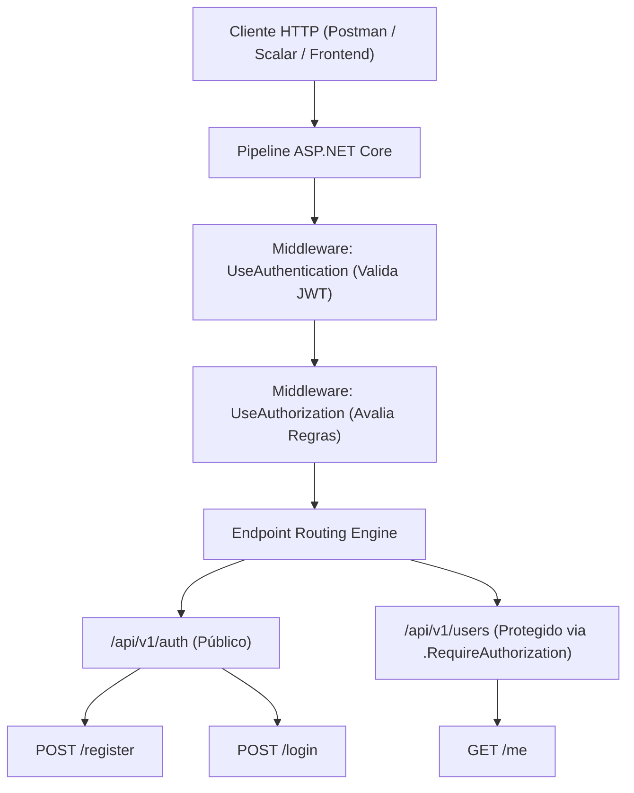

# UsersAPI - Documentação Técnica: Camada de Apresentação (Minimal APIs & JWT)

A camada **`FCG02.UsersAPI.API`** é o ponto de entrada HTTP da aplicação. Ela adota o modelo moderno de **Minimal APIs** do .NET 10 modularizado por grupos de rotas (*Route Groups*), autenticação stateless com **JWT Bearer** e documentação interativa com **Scalar**.

---

## 📑 Sumário

- [1. Visão Geral da Camada](#1-visão-geral-da-camada)
- [2. Mapeamento de Endpoints HTTP](#2-mapeamento-de-endpoints-http)
  - [2.1. `AuthEndpoints`: Registro e Login](#21-authendpoints-registro-e-login)
  - [2.2. `UserEndpoints`: Perfil Autenticado (`/me`)](#22-userendpoints-perfil-autenticado-me)
- [3. Pipeline de Segurança e Middlewares](#3-pipeline-de-segurança-e-middlewares)
  - [3.1. Configuração do JWT Bearer](#31-configuração-do-jwt-bearer)
  - [3.2. Diferença entre `AddAuthorization` e `UseAuthorization`](#32-diferença-entre-addauthorization-e-useauthorization)
- [4. Documentação OpenAPI Interativa com Scalar](#4-documentação-openapi-interativa-com-scalar)
- [5. O `Program.cs` Linha a Linha](#5-o-programcs-linha-a-linha)
- [6. Navegação](#6-navegação)

---

## 1. Visão Geral da Camada



---

## 2. Mapeamento de Endpoints HTTP

### 2.1. `AuthEndpoints`: Registro e Login

Localização: `src/FCG02.UsersAPI.API/Endpoints/AuthEndpoints.cs`

Utiliza métodos de extensão para manter o `Program.cs` modular:

```csharp
public static class AuthEndpoints
{
    public static IEndpointRouteBuilder MapAuthEndpoints(this IEndpointRouteBuilder app)
    {
        var group = app.MapGroup("/api/v1/auth")
                       .WithTags("Autenticação");

        // 1. Endpoint de Registro
        group.MapPost("/register", async (RegisterUserRequest request, IUserService userService) =>
        {
            try
            {
                var response = await userService.RegisterAsync(request);
                return Results.Created($"/api/v1/users/{response.Id}", response);
            }
            catch (ArgumentException ex)
            {
                return Results.BadRequest(new { error = ex.Message });
            }
            catch (InvalidOperationException ex)
            {
                return Results.Conflict(new { error = ex.Message });
            }
        })
        .WithName("RegisterUser")
        .WithSummary("Registrar novo usuário")
        .WithDescription("Cadastra um novo usuário no banco PostgreSQL e publica o evento UserCreatedEvent no RabbitMQ.")
        .Produces<UserResponse>(StatusCodes.Status201Created)
        .Produces(StatusCodes.Status400BadRequest)
        .Produces(StatusCodes.Status409Conflict);

        // 2. Endpoint de Login
        group.MapPost("/login", async (LoginRequest request, IAuthService authService) =>
        {
            try
            {
                var response = await authService.LoginAsync(request);
                return Results.Ok(response);
            }
            catch (ArgumentException ex)
            {
                return Results.BadRequest(new { error = ex.Message });
            }
            catch (UnauthorizedAccessException ex)
            {
                return Results.Json(new { error = ex.Message }, statusCode: StatusCodes.Status401Unauthorized);
            }
        })
        .WithName("LoginUser")
        .WithSummary("Autenticar usuário")
        .WithDescription("Valida as credenciais fornecidas e emite um Bearer Token JWT.")
        .Produces<AuthResponse>(StatusCodes.Status200OK)
        .Produces(StatusCodes.Status400BadRequest)
        .Produces(StatusCodes.Status401Unauthorized);

        return app;
    }
}
```

---

### 2.2. `UserEndpoints`: Perfil Autenticado (`/me`)

Localização: `src/FCG02.UsersAPI.API/Endpoints/UserEndpoints.cs`

A diretiva **`.RequireAuthorization()`** no grupo garante que qualquer requisição sem um token JWT válido seja imediatamente rejeitada com `401 Unauthorized`:

```csharp
public static class UserEndpoints
{
    public static IEndpointRouteBuilder MapUserEndpoints(this IEndpointRouteBuilder app)
    {
        var group = app.MapGroup("/api/v1/users")
                       .WithTags("Usuários")
                       .RequireAuthorization(); // Protege todos os endpoints filhos do grupo

        group.MapGet("/me", async (ClaimsPrincipal userPrincipal, IUserService userService) =>
        {
            // Extrai o ID do usuário diretamente das Claims criptografadas no token JWT
            var userIdClaim = userPrincipal.FindFirstValue(ClaimTypes.NameIdentifier);
            if (string.IsNullOrWhiteSpace(userIdClaim) || !Guid.TryParse(userIdClaim, out var userId))
                return Results.Unauthorized();

            var user = await userService.GetByIdAsync(userId);
            return user is not null ? Results.Ok(user) : Results.NotFound();
        })
        .WithName("GetCurrentUser")
        .WithSummary("Obter perfil autenticado")
        .WithDescription("Retorna os dados do usuário correspondente ao token Bearer JWT fornecido.")
        .Produces<UserResponse>(StatusCodes.Status200OK)
        .Produces(StatusCodes.Status401Unauthorized)
        .Produces(StatusCodes.Status404NotFound);

        return app;
    }
}
```

---

## 3. Pipeline de Segurança e Middlewares

### 3.1. Configuração do JWT Bearer

O middleware valida:
- **`ValidateIssuer`:** Garante que o emissor é `FCG02.UsersAPI`.
- **`ValidateAudience`:** Garante que o público-alvo é `FCG02.CloudGamesClients`.
- **`ValidateLifetime`:** Rejeita tokens com expiração ultrapassada (`ClockSkew = TimeSpan.Zero` para precisão imediata).
- **`ValidateIssuerSigningKey`:** Valida a assinatura digital contra a chave simétrica de no mínimo 256 bits.

### 3.2. Diferença entre `AddAuthorization` e `UseAuthorization`

- **`builder.Services.AddAuthorization()` (Container de Injeção de Dependências):** Registra os serviços essenciais de políticas e avaliação de claims. Sem essa chamada, a aplicação falha na inicialização com `InvalidOperationException`.
- **`app.UseAuthorization()` (Pipeline HTTP em Execução):** Adiciona o middleware na esteira de processamento por onde passam as requisições HTTP recebidas.

---

## 4. Documentação OpenAPI Interativa com Scalar

Em vez do Swagger UI tradicional, a aplicação utiliza **Scalar** (`Scalar.AspNetCore`), que consome o schema nativo do .NET 10 (`AddOpenApi()`):
- Interface de usuário moderna, rápida e responsiva.
- Testador interativo de endpoints com suporte nativo a autenticação Bearer.
- Tema escuro personalizado (`ScalarTheme.Moon`).

Acessível em: `http://localhost:PORTA/scalar/v1`.

---

## 5. O `Program.cs` Linha a Linha

Localização: `src/FCG02.UsersAPI.API/Program.cs`

```csharp
using System.Text;
using FCG02.UsersAPI.API.Endpoints;
using FCG02.UsersAPI.Application.Extensions;
using FCG02.UsersAPI.Infrastructure.Extensions;
using Microsoft.AspNetCore.Authentication.JwtBearer;
using Microsoft.IdentityModel.Tokens;
using Scalar.AspNetCore;

var builder = WebApplication.CreateBuilder(args);

// 1. Registra os serviços da Application e da Infrastructure
builder.Services.AddApplicationServices();
builder.Services.AddInfrastructureServices(builder.Configuration);

// 2. Configura a Autenticação JWT Bearer
var jwtSecret = builder.Configuration["Jwt:SecretKey"] 
    ?? throw new InvalidOperationException("A chave 'Jwt:SecretKey' não foi configurada.");
var jwtIssuer = builder.Configuration["Jwt:Issuer"] ?? "FCG02.UsersAPI";
var jwtAudience = builder.Configuration["Jwt:Audience"] ?? "FCG02.CloudGamesClients";

builder.Services.AddAuthentication(options =>
{
    options.DefaultAuthenticateScheme = JwtBearerDefaults.AuthenticationScheme;
    options.DefaultChallengeScheme = JwtBearerDefaults.AuthenticationScheme;
})
.AddJwtBearer(options =>
{
    options.TokenValidationParameters = new TokenValidationParameters
    {
        ValidateIssuer = true,
        ValidateAudience = true,
        ValidateLifetime = true,
        ValidateIssuerSigningKey = true,
        ValidIssuer = jwtIssuer,
        ValidAudience = jwtAudience,
        IssuerSigningKey = new SymmetricSecurityKey(Encoding.UTF8.GetBytes(jwtSecret)),
        ClockSkew = TimeSpan.Zero
    };
});

// 3. Registra os serviços de autorização
builder.Services.AddAuthorization();

// 4. OpenAPI nativo do .NET 10
builder.Services.AddOpenApi();

var app = builder.Build();

// 5. Pipeline HTTP
if (app.Environment.IsDevelopment())
{
    app.MapOpenApi();
    app.MapScalarApiReference(options =>
    {
        options.WithTitle("FIAP Cloud Games - UsersAPI");
        options.WithTheme(ScalarTheme.Moon);
    });
}

app.UseHttpsRedirection();

app.UseAuthentication();
app.UseAuthorization();

// 6. Registro limpo e desacoplado dos Route Groups
app.MapAuthEndpoints();
app.MapUserEndpoints();

app.Run();
```

---

## 6. Navegação

- ⬅️ **[Voltar para a Camada de Infraestrutura (`infrastructure.md`)](infrastructure.md)**
- ➡️ **[Avançar para a Suíte de Testes Unitários (`tests.md`)](tests.md)**
- 🐳 **[Avançar para Containerização e Docker (`docker.md`)](docker.md)**
