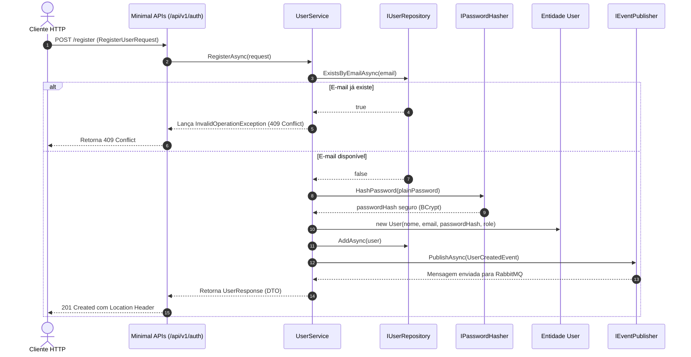

# UsersAPI - Documentação Técnica: Camada de Aplicação

A camada **`FCG02.UsersAPI.Application`** é responsável pela orquestração dos fluxos de casos de uso do sistema. Ela atua como mediadora entre os comandos vindos da camada de Apresentação (HTTP) e as regras de negócio puras do Domínio.

---

## 📑 Sumário

- [1. Visão Geral e Fluxo de Execução](#1-visão-geral-e-fluxo-de-execução)
- [2. Objetos de Transferência de Dados (DTOs)](#2-objetos-de-transferência-de-dados-dtos)
- [3. Evento de Integração: `UserCreatedEvent`](#3-evento-de-integração-usercreatedevent)
- [4. Abstrações e Portas de Saída (Interfaces)](#4-abstrações-e-portas-de-saída-interfaces)
- [5. Serviços de Caso de Uso](#5-serviços-de-caso-de-uso)
  - [5.1. `UserService`: Cadastro e Consulta](#51-userservice-cadastro-e-consulta)
  - [5.2. `AuthService`: Autenticação e Segurança OWASP](#52-authservice-autenticação-e-segurança-owasp)
- [6. Injeção de Dependências da Camada](#6-injeção-de-dependências-da-camada)
- [7. Navegação](#7-navegação)

---

## 1. Visão Geral e Fluxo de Execução



---

## 2. Objetos de Transferência de Dados (DTOs)

Localização: `src/FCG02.UsersAPI.Application/DTOs/`

Todos os DTOs utilizam a palavra-chave **`record`** do C#, garantindo **imutabilidade posicional** e menor custo de alocação de memória.

### Por que DTOs ao invés de expor a Entidade `User`?
- **Segurança:** A entidade `User` possui a propriedade sensível `PasswordHash`. Expor a entidade diretamente em endpoints REST é uma falha grave de segurança.
- **Desacoplamento de Contrato:** Alterações na tabela ou entidade interna não quebram os clientes que consomem a API pública.

```csharp
// DTO de entrada para registro
public record RegisterUserRequest(
    string Name,
    string Email,
    string Password,
    UserRole Role = UserRole.Gamer
);

// DTO de entrada para login
public record LoginRequest(
    string Email,
    string Password
);

// DTO de saída seguro sem campos sensíveis
public record UserResponse(
    Guid Id,
    string Name,
    string Email,
    UserRole Role,
    DateTime CreatedAt
)
{
    // Método fábrica para conversão expressiva a partir da entidade
    public static UserResponse FromEntity(User user) =>
        new(user.Id, user.Name, user.Email.Value, user.Role, user.CreatedAt);
}

// Resposta de autenticação contendo o JWT
public record AuthResponse(
    string AccessToken,
    string TokenType,
    int ExpiresInSeconds,
    UserResponse User
);
```

---

## 3. Evento de Integração: `UserCreatedEvent`

Localização: `src/FCG02.UsersAPI.Application/Events/UserCreatedEvent.cs`

Representa o fato de que um novo jogador foi cadastrado no sistema. Este contrato é serializado e publicado na fila de mensageria para consumo assíncrono pela `NotificationsAPI`:

```csharp
using FCG02.UsersAPI.Domain.Enums;

namespace FCG02.UsersAPI.Application.Events;

public record UserCreatedEvent(
    Guid EventId,
    DateTime OccurredOn,
    Guid UserId,
    string Name,
    string Email,
    UserRole Role
);
```

---

## 4. Abstrações e Portas de Saída (Interfaces)

Localização: `src/FCG02.UsersAPI.Application/Interfaces/`

A camada de Aplicação declara exatamente o que necessita para executar suas funções, sem acoplar-se a bibliotecas específicas:

| Interface | Finalidade | Implementação Concreta (Infraestrutura) |
|---|---|---|
| **`IPasswordHasher`** | Criptografia de senhas em mão única com Salt. | `BCrypt.Net-Next` (`PasswordHasher.cs`) |
| **`ITokenService`** | Geração e assinatura de JWT Bearer. | `System.IdentityModel.Tokens.Jwt` (`TokenService.cs`) |
| **`IEventPublisher`** | Publicação não-bloqueante de eventos assíncronos. | `RabbitMQ.Client` (`RabbitMqEventPublisher.cs`) |
| **`IUserService`** | Caso de uso de cadastro e consulta de usuário. | `UserService.cs` (Na própria Application) |
| **`IAuthService`** | Caso de uso de autenticação de credenciais. | `AuthService.cs` (Na própria Application) |

---

## 5. Serviços de Caso de Uso

### 5.1. `UserService`: Cadastro e Consulta

Localização: `src/FCG02.UsersAPI.Application/Services/UserService.cs`

```csharp
public class UserService : IUserService
{
    private readonly IUserRepository _userRepository;
    private readonly IPasswordHasher _passwordHasher;
    private readonly IEventPublisher _eventPublisher;

    public UserService(
        IUserRepository userRepository,
        IPasswordHasher passwordHasher,
        IEventPublisher eventPublisher)
    {
        _userRepository = userRepository;
        _passwordHasher = passwordHasher;
        _eventPublisher = eventPublisher;
    }

    public async Task<UserResponse> RegisterAsync(
        RegisterUserRequest request, 
        CancellationToken cancellationToken = default)
    {
        ArgumentNullException.ThrowIfNull(request);

        if (string.IsNullOrWhiteSpace(request.Password))
            throw new ArgumentException("A senha não pode ser vazia.", nameof(request.Password));

        // 1. Instanciação e sanitização pelo Value Object
        var email = new Email(request.Email);

        // 2. Validação otimizada de unicidade cadastral
        var alreadyExists = await _userRepository.ExistsByEmailAsync(email.Value, cancellationToken);
        if (alreadyExists)
            throw new InvalidOperationException($"Já existe um usuário cadastrado com o e-mail '{email.Value}'.");

        // 3. Aplicação do algoritmo de hash adaptativo (BCrypt)
        var passwordHash = _passwordHasher.HashPassword(request.Password);

        // 4. Instanciação da Entidade Rica
        var user = new User(request.Name, email, passwordHash, request.Role);

        // 5. Persistência relacional
        await _userRepository.AddAsync(user, cancellationToken);

        // 6. Emissão do evento de integração para o broker RabbitMQ
        var userCreatedEvent = new UserCreatedEvent(
            EventId: Guid.NewGuid(),
            OccurredOn: DateTime.UtcNow,
            UserId: user.Id,
            Name: user.Name,
            Email: user.Email.Value,
            Role: user.Role
        );
        await _eventPublisher.PublishAsync(userCreatedEvent, cancellationToken);

        // 7. Retorno do DTO de resposta sem campos sensíveis
        return UserResponse.FromEntity(user);
    }

    public async Task<UserResponse?> GetByIdAsync(Guid id, CancellationToken cancellationToken = default)
    {
        var user = await _userRepository.GetByIdAsync(id, cancellationToken);
        return user is null ? null : UserResponse.FromEntity(user);
    }
}
```

---

### 5.2. `AuthService`: Autenticação e Segurança OWASP

Localização: `src/FCG02.UsersAPI.Application/Services/AuthService.cs`

> 🛡️ **Segurança Contra Account Enumeration (OWASP):**  
> Caso o e-mail não seja encontrado **OU** a senha esteja incorreta, a aplicação lança a mesma mensagem padronizada: `"Credenciais inválidas."`. Isso impede que atacantes automatizados descubram se um e-mail específico possui ou não cadastro na plataforma através da resposta do servidor.

```csharp
public class AuthService : IAuthService
{
    private readonly IUserRepository _userRepository;
    private readonly IPasswordHasher _passwordHasher;
    private readonly ITokenService _tokenService;

    public AuthService(
        IUserRepository userRepository,
        IPasswordHasher passwordHasher,
        ITokenService tokenService)
    {
        _userRepository = userRepository;
        _passwordHasher = passwordHasher;
        _tokenService = tokenService;
    }

    public async Task<AuthResponse> LoginAsync(
        LoginRequest request, 
        CancellationToken cancellationToken = default)
    {
        ArgumentNullException.ThrowIfNull(request);

        if (string.IsNullOrWhiteSpace(request.Email) || string.IsNullOrWhiteSpace(request.Password))
            throw new ArgumentException("E-mail e senha são obrigatórios.");

        var email = new Email(request.Email);

        // 1. Busca pelo e-mail sanitizado
        var user = await _userRepository.GetByEmailAsync(email.Value, cancellationToken);
        if (user is null)
            throw new UnauthorizedAccessException("Credenciais inválidas.");

        // 2. Validação da senha contra o hash criptográfico
        var isPasswordValid = _passwordHasher.VerifyPassword(request.Password, user.PasswordHash);
        if (!isPasswordValid)
            throw new UnauthorizedAccessException("Credenciais inválidas.");

        // 3. Geração do token JWT com claims e tempo de expiração
        var token = _tokenService.GenerateToken(user);
        var expirationSeconds = _tokenService.GetTokenExpirationInSeconds();

        return new AuthResponse(
            AccessToken: token,
            TokenType: "Bearer",
            ExpiresInSeconds: expirationSeconds,
            User: UserResponse.FromEntity(user)
        );
    }
}
```

---

## 6. Injeção de Dependências da Camada

Localização: `src/FCG02.UsersAPI.Application/Extensions/DependencyInjection.cs`

Para manter o `Program.cs` limpo, a própria camada expõe um método de extensão que registra seus serviços:

```csharp
namespace FCG02.UsersAPI.Application.Extensions;

public static class DependencyInjection
{
    public static IServiceCollection AddApplicationServices(this IServiceCollection services)
    {
        services.AddScoped<IUserService, UserService>();
        services.AddScoped<IAuthService, AuthService>();

        return services;
    }
}
```

---

## 7. Navegação

- ⬅️ **[Voltar para a Camada de Domínio (`domain.md`)](domain.md)**
- ➡️ **[Avançar para a Camada de Infraestrutura (`infrastructure.md`)](infrastructure.md)**
- 🧪 **[Ver os Testes Unitários de Aplicação com Moq (`tests.md`)](tests.md)**
