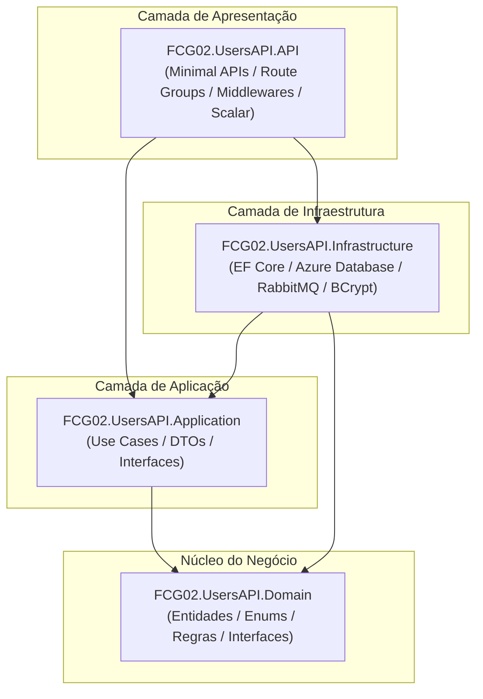

# UsersAPI - Documentação de Arquitetura

O **UsersAPI** é o microsserviço responsável pela gestão de identidade, controle de acesso e ciclo de vida de usuários da plataforma **FIAP Cloud Games**.

---

## 📑 Sumário

- [1. Visão Geral e Responsabilidades](#1-visão-geral-e-responsabilidades)
- [2. Padrão Arquitetural: Clean Architecture (.NET 10+)](#2-padrão-arquitetural-clean-architecture-net-10)
  - [2.1. Regra de Dependência](#21-regra-de-dependência)
  - [2.2. Decisão Arquitetural: Minimal APIs vs Controllers](#22-decisão-arquitetural-minimal-apis-vs-controllers)
- [3. Banco de Dados: Azure Database](#3-banco-de-dados-azure-database)
  - [3.1. Esquema Conceitual de Dados](#31-esquema-conceitual-de-dados)
- [4. Integração de Eventos (RabbitMQ)](#4-integração-de-eventos-rabbitmq)

---

## 1. Visão Geral e Responsabilidades

- **Cadastro de Usuários:** Criação de conta com hash seguro de senha e validação de unicidade de e-mail.
- **Autenticação & JWT:** Emissão e validação de tokens JWT para sessões de usuários.
- **Perfis de Acesso (Roles):**
  - `anonymous`: Usuário não autenticado ou com acesso restrito a navegação.
  - `gamer`: Usuário jogador (compra de jogos, visualização de biblioteca).
  - `admin`: Usuário administrador (gestão de catálogo e usuários).
- **Publicação de Eventos:** Emissão do evento `UserCreatedEvent` via RabbitMQ após o cadastro de um novo usuário.

---

## 2. Padrão Arquitetural: Clean Architecture (.NET 10+)

A solução é organizada segundo a **Clean Architecture** (Arquitetura Limpa), adotando **.NET 10 (`net10.0`)**, formato de solução `.slnx` e **Minimal APIs** para a camada de apresentação. Isso garante máxima performance, menor footprint de memória e total isolamento das regras de negócio (Domínio):

```text
fcg-fase-02--users/
├── FCG02.UsersAPI.slnx           # Solução .NET 10 no formato moderno slnx
├── README.md                     # Visão geral do repositório e guia de execução
├── docs/                         # Documentação técnica detalhada
│   ├── index.md                  # Índice geral da documentação
│   ├── architecture.md           # Visão arquitetural e padrões de design
│   ├── domain.md                 # Camada de Domínio e DDD
│   ├── application.md            # Camada de Aplicação e Casos de Uso
│   ├── infrastructure.md         # Camada de Infraestrutura, EF Core e RabbitMQ
│   ├── api.md                    # Camada de Apresentação, Minimal APIs e JWT
│   ├── tests.md                  # Suíte de testes unitários com xUnit e Moq
│   └── docker.md                 # Containerização com Docker Multi-stage
├── src/
│   ├── FCG02.UsersAPI.Domain/          # Núcleo: Entidades, Value Objects, Enums e Interfaces de Repositório
│   ├── FCG02.UsersAPI.Application/     # Casos de uso: DTOs, Services/Use Cases, Interfaces (Token, Eventos)
│   ├── FCG02.UsersAPI.Infrastructure/  # Azure Database (EF Core SQL Server), BCrypt, RabbitMQ Publisher
│   └── FCG02.UsersAPI.API/             # Minimal APIs (Route Groups), Middlewares, Scalar (OpenAPI) e Program.cs
└── tests/
    └── FCG02.UsersAPI.UnitTests/       # Testes unitários de Domínio e Casos de Uso
```

### 2.1. Regra de Dependência


- **Domain:** Não referencia nenhum outro projeto. Não referencia EF Core nem bibliotecas externas.
- **Application:** Referencia apenas o **Domain**.
- **Infrastructure:** Referencia **Application** e **Domain**.
- **API:** Referencia **Application** e **Infrastructure** (para configuração do container de DI no `Program.cs`).

### 2.2. Decisão Arquitetural: Minimal APIs vs Controllers
- **Padrão Escolhido:** **Minimal APIs** modulares por contexto de negócio (ex.: `AuthEndpoints.cs`, `UserEndpoints.cs`).
- **Justificativas Técnicas:**
  1. **Performance e Cold-Start:** Inicialização substancialmente mais rápida que Controllers convencionais, eliminando camadas desnecessárias da pipeline do MVC (filtros complexos, action invoker, reflection pesada).
  2. **Adequação a Serverless / Cloud-Native:** Ideal para escalonamento elástico no Azure (Container Apps com scale-to-zero ou Azure Functions), reduzindo latência da primeira requisição.
  3. **Preparação para Native AOT:** No .NET 10, Minimal APIs possuem suporte nativo de primeira classe para compilação antecipada (Native AOT), permitindo contêineres minúsculos (<30MB) e consumo de RAM na faixa de 15MB a 30MB.
  4. **Modularização Limpa:** A organização das rotas através de métodos de extensão (`app.MapGroup("/api/v1/auth")`) garante código coeso e desacoplado, sem sobrecarregar o `Program.cs`.
- **Domain:** Não referencia nenhum outro projeto. Não referencia EF Core nem bibliotecas externas.
- **Application:** Referencia apenas o **Domain**.
- **Infrastructure:** Referencia **Application** e **Domain**.
- **API:** Referencia **Application** e **Infrastructure** (para configuração do container de DI no `Program.cs`).

---

## 3. Banco de Dados: Azure Database

- **SGBD:** **Azure Database** (Azure SQL Database na nuvem, servidor `fcg-server.database.windows.net`, porta `1433`).
- **Banco Dedicado:** `fcg-02-usersdb` (*Database-per-Service*).
- **ORM:** Entity Framework Core (`Microsoft.EntityFrameworkCore.SqlServer`).
- **Resiliência:** Conexão criptografada TLS/SSL com tolerância a falhas transitórias ativada via `sqlOptions.EnableRetryOnFailure()`.
- **Mapeamento:** Fluent API (`IEntityTypeConfiguration<T>`) na camada de `Infrastructure`, mantendo o `Domain` livre de anotações de dados de banco.
- **Migrações:** Gerenciadas via EF Core Migrations (`InitialAzureCreate`).

### 3.1. Esquema Conceitual de Dados

Tabela: `Users`
- `Id` (UNIQUEIDENTIFIER/Guid, PK)
- `Name` (NVARCHAR(150), NOT NULL)
- `Email` (NVARCHAR(200), NOT NULL, UNIQUE INDEX)
- `PasswordHash` (NVARCHAR(255), NOT NULL)
- `Role` (NVARCHAR(20) ou INT, NOT NULL - `anonymous`, `gamer`, `admin`)
- `CreatedAt` (DATETIME2, NOT NULL)
- `UpdatedAt` (DATETIME2, NULL)

---

## 4. Integração de Eventos (RabbitMQ)

Ao persistir um novo usuário com sucesso no Azure Database:
1. A camada de aplicação invoca o `IEventPublisher`.
2. O evento `UserCreatedEvent` é publicado na exchange do RabbitMQ (`users.events` ou `amq.topic`).
3. Payload do evento:
   ```json
   {
     "eventId": "UUID",
     "occurredOn": "2026-10-03T10:00:00Z",
     "userId": "UUID",
     "name": "Nome do Usuário",
     "email": "usuario@exemplo.com",
     "role": "gamer"
   }
   ```

---

## 5. Navegação

- 🏠 **[Voltar para o Índice da Documentação (index.md)](index.md)**
- ➡️ **[Avançar para a Camada de Domínio (domain.md)](domain.md)**
- ⚙️ **[Avançar para a Camada de Aplicação (application.md)](application.md)**
- 🚀 **[Voltar para o README Principal](../README.md)**
