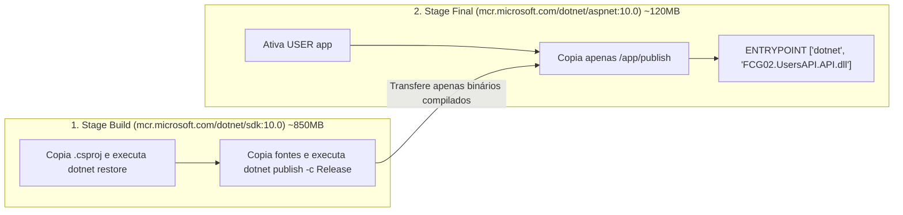

# UsersAPI - Documentação Técnica: Containerização & Docker

Este documento detalha o processo de empacotamento da **UsersAPI** em containers Docker otimizados para produção, utilizando **Multi-stage Builds** e o usuário não-root nativo do .NET 10 (**`USER app`**).

---

## 📑 Sumário

- [1. Estratégia de Multi-stage Build](#1-estratégia-de-multi-stage-build)
- [2. O `Dockerfile` Explicado](#2-o-dockerfile-explicado)
- [3. O Arquivo `.dockerignore`](#3-o-arquivo-dockerignore)
- [4. Segurança: Execução Não-Root (`USER app`)](#4-segurança-execução-não-root-user-app)
- [5. Comandos de Build e Execução Manual](#5-comandos-de-build-e-execução-manual)
- [6. Navegação](#6-navegação)

---

## 1. Estratégia de Multi-stage Build

A compilação em múltiplos estágios separa o ambiente pesado de desenvolvimento (compiladores, SDKs, ferramentas de diagnóstico) do ambiente enxuto de execução em produção:



### Principais Benefícios:
- **Redução Drástica de Tamanho:** A imagem final cai de mais de 850MB para aproximadamente 120MB.
- **Segurança Reforçada:** O compilador C# e ferramentas de linha de comando não estão presentes na imagem de produção, reduzindo a superfície de ataque.
- **Cache Inteligente de Camadas:** Os arquivos `.csproj` são copiados antes do código-fonte. Alterações no código C# não invalidam o cache da restauração de pacotes NuGet (`dotnet restore`).

---

## 2. O `Dockerfile` Explicado

Localização: `fcg-fase-02--users/Dockerfile`

```dockerfile
# =========================================================================
# ESTÁGIO 1: Compilação e Publicação dos Artefatos
# =========================================================================
FROM mcr.microsoft.com/dotnet/sdk:10.0 AS build
WORKDIR /src

# 1. Copia apenas os arquivos de projeto preservando a estrutura de pastas
# Isso maximiza o reuso do cache do Docker para o restore do NuGet
COPY src/FCG02.UsersAPI.Domain/FCG02.UsersAPI.Domain.csproj src/FCG02.UsersAPI.Domain/
COPY src/FCG02.UsersAPI.Application/FCG02.UsersAPI.Application.csproj src/FCG02.UsersAPI.Application/
COPY src/FCG02.UsersAPI.Infrastructure/FCG02.UsersAPI.Infrastructure.csproj src/FCG02.UsersAPI.Infrastructure/
COPY src/FCG02.UsersAPI.API/FCG02.UsersAPI.API.csproj src/FCG02.UsersAPI.API/

# 2. Restaura as dependências externas
RUN dotnet restore src/FCG02.UsersAPI.API/FCG02.UsersAPI.API.csproj

# 3. Copia o código-fonte restante de todos os projetos
COPY src/ src/

# 4. Compila em modo Release gerando as DLLs otimizadas
RUN dotnet publish src/FCG02.UsersAPI.API/FCG02.UsersAPI.API.csproj -c Release -o /app/publish /p:UseAppHost=false

# =========================================================================
# ESTÁGIO 2: Imagem Final de Execução (Runtime Mínimo)
# =========================================================================
FROM mcr.microsoft.com/dotnet/aspnet:10.0 AS final
WORKDIR /app

# 5. Ativa o usuário sem privilégios de root nativo do .NET 8/9/10
USER app

# 6. Configura a porta padrão do ASP.NET Core em containers não-root
EXPOSE 8080
ENV ASPNETCORE_URLS=http://+:8080

# 7. Copia exclusivamente os binários compilados do estágio 1
COPY --from=build /app/publish .

# 8. Define o ponto de entrada da aplicação
ENTRYPOINT ["dotnet", "FCG02.UsersAPI.API.dll"]
```

---

## 3. O Arquivo `.dockerignore`

Localização: `fcg-fase-02--users/.dockerignore`

Evita o envio desnecessário de pastas locais e artefatos de compilação para o daemon do Docker:

```dockerignore
**/.git
**/.vs
**/.vscode
**/bin
**/obj
**/*.user
**/*.suo
**/Dockerfile*
README.md
docs/
```

---

## 4. Segurança: Execução Não-Root (`USER app`)

Por padrão, contêineres Docker executam processos como superusuário `root` (UID 0). Em cenários de nuvem, se um atacante conseguir explorar uma vulnerabilidade de execução remota de código (RCE), ele herda privilégios de administrador dentro do container.

A diretiva **`USER app`** instrui o container a rodar sob o usuário de baixa permissão pré-configurado pela Microsoft nas imagens base do .NET:
- UID: `1654`
- Atende aos requisitos do **CIS Docker Benchmark** e políticas corporativas de segurança em Kubernetes.

---

## 5. Comandos de Build e Execução Manual

```powershell
# 1. Construir a imagem Docker
docker build -t fcg02-users-api:latest .

# 2. Executar o container apontando para o PostgreSQL e RabbitMQ da máquina host
docker run -d --name users-api -p 8080:8080 `
  -e ConnectionStrings__DefaultConnection="Host=host.docker.internal;Port=5432;Database=usersdb;User Id=postgres;Password=postgres;" `
  -e RabbitMQ__HostName="host.docker.internal" `
  fcg02-users-api:latest
```

> 💡 **Nota de Orquestração:** Em desenvolvimento unificado, o container é gerenciado diretamente pelo Docker Compose em `fcg-fase-02--orchestration/docker-compose.yml`, onde as redes bridge e dependências de inicialização são resolvidas automaticamente.

---

## 6. Navegação

- ⬅️ **[Voltar para os Testes Unitários (`tests.md`)](tests.md)**
- 🏠 **[Voltar para o Índice da Documentação](index.md)**
- 🚀 **[Voltar para o README Principal](../README.md)**
