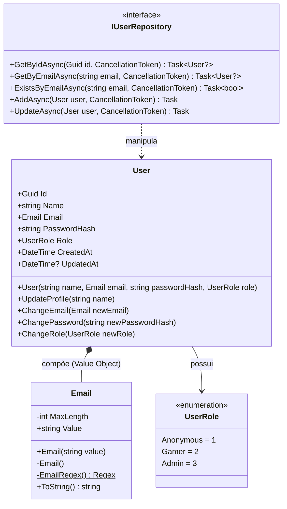

# UsersAPI - Documentação Técnica: Camada de Domínio

A camada **`FCG02.UsersAPI.Domain`** é o núcleo de regras de negócio do microsserviço. Ela é estritamente isolada de preocupações tecnológicas, frameworks web e bancos de dados, implementando os conceitos fundamentais de **Domain-Driven Design (DDD)**.

---

## 📑 Sumário

- [1. Visão Geral e Diagrama de Classes](#1-visão-geral-e-diagrama-de-classes)
- [2. Entidade de Domínio: `User`](#2-entidade-de-domínio-user)
  - [2.1. Princípio da Entidade Rica](#21-princípio-da-entidade-rica)
  - [2.2. Explicação do Código da Entidade](#22-explicação-do-código-da-entidade)
- [3. Value Object (Objeto de Valor): `Email`](#3-value-object-objeto-de-valor-email)
  - [3.1. Eliminação do Antipadrão Primitive Obsession](#31-eliminação-do-antipadrão-primitive-obsession)
  - [3.2. Explicação do Código do Value Object](#32-explicação-do-código-do-value-object)
- [4. Enum de Perfis de Acesso: `UserRole`](#4-enum-de-perfis-de-acesso-userrole)
- [5. Porta de Saída do Repositório: `IUserRepository`](#5-porta-de-saída-do-repositório-iuserrepository)
- [6. Navegação](#6-navegação)

---

## 1. Visão Geral e Diagrama de Classes



---

## 2. Entidade de Domínio: `User`

Localização: `src/FCG02.UsersAPI.Domain/Entities/User.cs`

### 2.1. Princípio da Entidade Rica
A classe `User` não é um modelo anêmico com apenas getters e setters públicos. Todas as propriedades possuem **`private set`**, o que significa que o estado de um usuário só pode ser alterado através de métodos explícitos de negócio que garantem que as invariantes nunca sejam violadas.

### 2.2. Explicação do Código da Entidade

```csharp
namespace FCG02.UsersAPI.Domain.Entities;

public class User
{
    // Identificador único imutável
    public Guid Id { get; private set; }
    
    // Nome com proteção de encapsulamento
    public string Name { get; private set; } = string.Empty;
    
    // Value Object fortemente tipado
    public Email Email { get; private set; } = null!;
    
    // Hash criptográfico gerado externamente por um IPasswordHasher
    public string PasswordHash { get; private set; } = string.Empty;
    
    // Papel de autorização do usuário
    public UserRole Role { get; private set; }
    
    // Auditoria temporal em UTC
    public DateTime CreatedAt { get; private set; }
    public DateTime? UpdatedAt { get; private set; }

    // Construtor sem parâmetros exigido pelo ORM (EF Core) para materialização via reflexão
    private User() { }

    // Construtor público que valida e garante o estado consistente na criação
    public User(string name, Email email, string passwordHash, UserRole role = UserRole.Gamer)
    {
        if (string.IsNullOrWhiteSpace(name))
            throw new ArgumentException("O nome do usuário não pode ser vazio.", nameof(name));

        ArgumentNullException.ThrowIfNull(email, nameof(email));

        if (string.IsNullOrWhiteSpace(passwordHash))
            throw new ArgumentException("O hash da senha é obrigatório.", nameof(passwordHash));

        Id = Guid.NewGuid();
        Name = name.Trim();
        Email = email;
        PasswordHash = passwordHash;
        Role = role;
        CreatedAt = DateTime.UtcNow;
    }

    // Método explícito de negócio para atualização cadastral
    public void UpdateProfile(string name)
    {
        if (string.IsNullOrWhiteSpace(name))
            throw new ArgumentException("O nome do usuário não pode ser vazio.", nameof(name));

        Name = name.Trim();
        UpdatedAt = DateTime.UtcNow;
    }

    // Alteração segura do e-mail com rastreamento de atualização
    public void ChangeEmail(Email newEmail)
    {
        ArgumentNullException.ThrowIfNull(newEmail, nameof(newEmail));

        Email = newEmail;
        UpdatedAt = DateTime.UtcNow;
    }

    // Alteração de senha protegida
    public void ChangePassword(string newPasswordHash)
    {
        if (string.IsNullOrWhiteSpace(newPasswordHash))
            throw new ArgumentException("O novo hash da senha é obrigatório.", nameof(newPasswordHash));

        PasswordHash = newPasswordHash;
        UpdatedAt = DateTime.UtcNow;
    }

    // Promoção ou rebaixamento de papel de acesso
    public void ChangeRole(UserRole newRole)
    {
        Role = newRole;
        UpdatedAt = DateTime.UtcNow;
    }
}
```

---

## 3. Value Object (Objeto de Valor): `Email`

Localização: `src/FCG02.UsersAPI.Domain/ValueObjects/Email.cs`

### 3.1. Eliminação do Antipadrão Primitive Obsession
Em vez de utilizar uma `string` genérica para representar o e-mail:
- Uma `string` comum pode conter qualquer texto ou até valores nulos/vazios, exigindo validações espalhadas por toda a aplicação.
- O Value Object `Email` é **auto-validável**: se uma instância existe em memória, ela é comprovadamente válida.
- É **imutável** e possui **igualdade estrutural**: dois e-mails com as mesmas letras (independentemente de maiúsculas ou minúsculas) são considerados iguais.

### 3.2. Explicação do Código do Value Object

```csharp
using System.Text.RegularExpressions;

namespace FCG02.UsersAPI.Domain.ValueObjects;

// Utiliza 'record class' para igualdade estrutural automática e 'partial' para Source Generator de Regex
public sealed partial record Email
{
    private const int MaxLength = 256;

    public string Value { get; }

    // Construtor sem parâmetros para suporte do EF Core
    private Email() 
    {
        Value = string.Empty;
    }

    public Email(string value)
    {
        if (string.IsNullOrWhiteSpace(value))
            throw new ArgumentException("O e-mail não pode ser vazio ou nulo.", nameof(value));

        // Normalização garantida: trim e letras minúsculas
        var sanitized = value.Trim().ToLowerInvariant();

        if (sanitized.Length > MaxLength)
            throw new ArgumentException($"O e-mail não pode ter mais de {MaxLength} caracteres.", nameof(value));

        if (!EmailRegex.IsMatch(sanitized))
            throw new ArgumentException("O formato do e-mail é inválido.", nameof(value));

        Value = sanitized;
    }

    // Instância estática pré-compilada da Regex via construtor estático (RegexOptions.Compiled)
    private static readonly Regex EmailRegex;
    static Email()
    {
        EmailRegex = new Regex(@"^[^@\s]+@[^@\s]+\.[^@\s]+$", RegexOptions.Compiled | RegexOptions.IgnoreCase);
    }

    // Permite converter implicitamente o objeto Email para string sem precisar de .Value
    public static implicit operator string(Email email) => email.Value;

    // Permite conversão explícita de string para Email: (Email)"user@fiap.com.br"
    public static explicit operator Email(string value) => new(value);

    public override string ToString() => Value;
}
```

---

## 4. Enum de Perfis de Acesso: `UserRole`

Localização: `src/FCG02.UsersAPI.Domain/Enums/UserRole.cs`

Define as permissões do sistema no modelo **Role-Based Access Control (RBAC)**:

```csharp
namespace FCG02.UsersAPI.Domain.Enums;

public enum UserRole
{
    Anonymous = 1, // Visitante não autenticado com permissões de leitura
    Gamer = 2,     // Jogador autenticado com acesso a compras e biblioteca
    Admin = 3      // Administrador com acesso a gerenciamento de catálogo e usuários
}
```

---

## 5. Porta de Saída do Repositório: `IUserRepository`

Localização: `src/FCG02.UsersAPI.Domain/Interfaces/IUserRepository.cs`

Em conformidade com o **Princípio da Inversão de Dependência (D do SOLID)**, o Domínio declara o contrato de persistência que necessita, mas não possui qualquer conhecimento sobre como ou onde esses dados serão gravados (Azure Database, SQL Server, Memória):

```csharp
using FCG02.UsersAPI.Domain.Entities;

namespace FCG02.UsersAPI.Domain.Interfaces;

public interface IUserRepository
{
    Task<User?> GetByIdAsync(Guid id, CancellationToken cancellationToken = default);
    Task<User?> GetByEmailAsync(string email, CancellationToken cancellationToken = default);
    Task<bool> ExistsByEmailAsync(string email, CancellationToken cancellationToken = default);
    Task AddAsync(User user, CancellationToken cancellationToken = default);
    Task UpdateAsync(User user, CancellationToken cancellationToken = default);
}
```

> ⚡ **Destaque:** O método `ExistsByEmailAsync` permite que o serviço de aplicação valide a unicidade cadastral sem precisar carregar a entidade completa para a memória, otimizando drasticamente a consulta SQL com `SELECT EXISTS(...)`.

---

## 6. Navegação

- ⬅️ **[Voltar para o Índice da Documentação](index.md)**
- ➡️ **[Avançar para a Camada de Aplicação (`application.md`)](application.md)**
- 🧪 **[Ver os Testes Unitários de Domínio (`tests.md`)](tests.md)**
