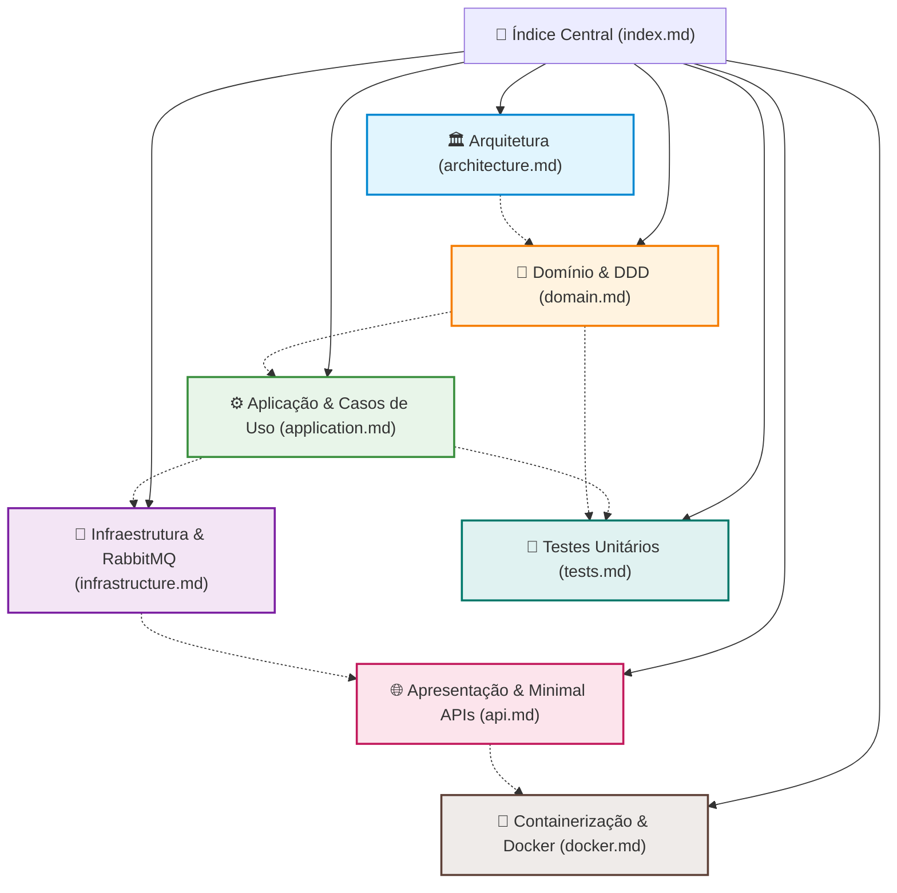

# UsersAPI - Índice da Documentação Técnica

Bem-vindo à documentação técnica oficial da **UsersAPI** (`fcg-fase-02--users`), microsserviço de gestão de identidade, usuários e controle de acesso da plataforma **FIAP Cloud Games**.

---

## 🗺️ Mapa de Navegação da Documentação

---

## 📚 Módulos de Documentação

### 1. [🏛️ Arquitetura da Solução (`architecture.md`)](architecture.md)
Visão geral da Clean Architecture adotada, regras de dependência estrita, motivação técnica da escolha de Minimal APIs em vez de Controllers e esquema conceitual de dados.

### 2. [🧩 Camada de Domínio (`domain.md`)](domain.md)
Detalhamento do núcleo de negócio:
- Entidade rica `User` com propriedades encapsuladas e invariantes protegidas.
- Value Object `Email` eliminando o antipadrão *Primitive Obsession*, com Expressão Regular pré-compilada (`RegexOptions.Compiled`).
- Enum `UserRole` e interface de repositório `IUserRepository` (Inversão de Dependência).

### 3. [⚙️ Camada de Aplicação (`application.md`)](application.md)
Detalhamento da orquestração dos casos de uso:
- DTOs imutáveis (`record`) para requisições e respostas.
- Contrato do evento assíncrono `UserCreatedEvent`.
- Interfaces de suporte (`IPasswordHasher`, `ITokenService`, `IEventPublisher`).
- Implementação dos serviços `UserService` e `AuthService` com proteção contra ataques de enumeração de contas (OWASP).

### 4. [🔌 Camada de Infraestrutura (`infrastructure.md`)](infrastructure.md)
Detalhamento da persistência e comunicação externa:
- Configuração do Entity Framework Core com `Npgsql` (PostgreSQL 17).
- Mapeamento objeto-relacional via Fluent API (`IEntityTypeConfiguration<User>`) e conversor de valor para o Value Object `Email`.
- Hashing adaptativo com `BCrypt.Net-Next`.
- Emissão de tokens JWT com assinatura HMAC-SHA256 (`TokenService`).
- Publicação resiliente de mensagens no RabbitMQ via Topic Exchange (`fcg.users.events`).

### 5. [🌐 Camada de Apresentação (`api.md`)](api.md)
Detalhamento dos endpoints HTTP e pipeline ASP.NET Core:
- Modularização com Route Groups (`MapGroup`) em `AuthEndpoints` e `UserEndpoints`.
- Autenticação e Autorização baseada em Claims e Roles (`.RequireAuthorization()`).
- Documentação interativa moderna com **Scalar** (`Scalar.AspNetCore`).
- Explicação do `Program.cs`.

### 6. [🧪 Suíte de Testes Unitários (`tests.md`)](tests.md)
Guia de testes automatizados com xUnit e Moq:
- Padrão AAA (*Arrange, Act, Assert*).
- Testes parametrizados de domínio com `[Theory]` e `[InlineData]`.
- Mocks determinísticos de repositório, hasher e publicador de mensageria na camada de Aplicação.

### 7. [🐳 Containerização com Docker (`docker.md`)](docker.md)
Guia de empacotamento para ambientes de nuvem:
- `Dockerfile` multi-stage com otimização de camadas de cache.
- Execução segura com usuário não-privilegiado (`USER app`).
- Diretivas do `.dockerignore` e comandos de execução.

