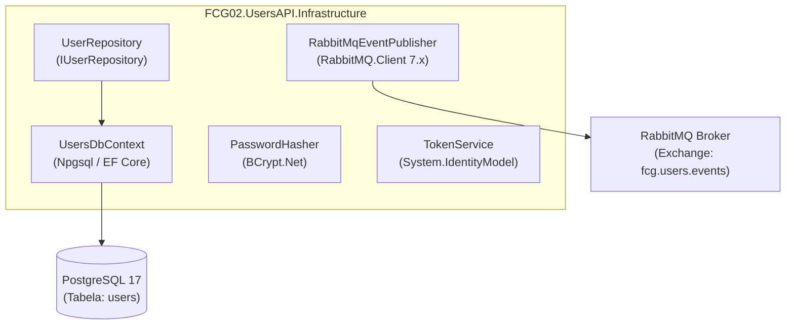
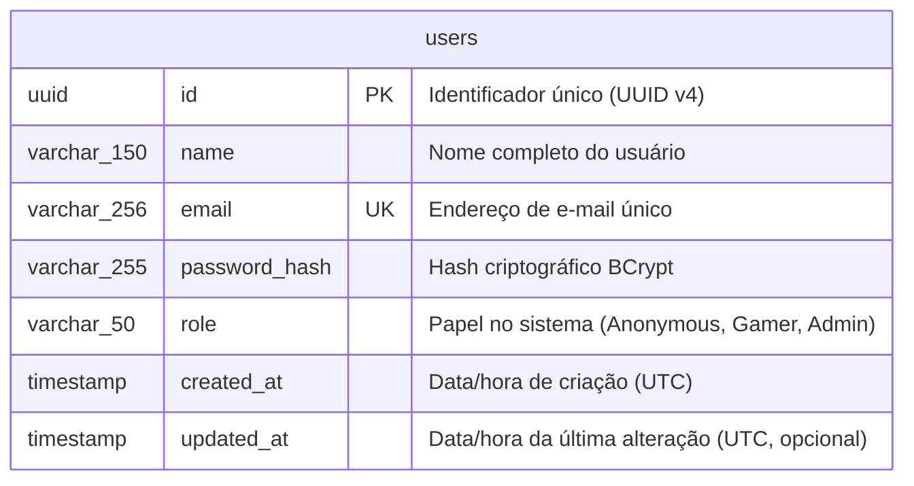

# UsersAPI - Documentação Técnica: Camada de Infraestrutura

A camada **`FCG02.UsersAPI.Infrastructure`** implementa os detalhes tecnológicos e mecanismos de entrada/saída do microsserviço: persistência relacional com Entity Framework Core e PostgreSQL 17, criptografia de senhas, emissão de tokens JWT e publicação de eventos assíncronos no RabbitMQ.

---

## 📑 Sumário

- [1. Visão Geral da Camada](#1-visão-geral-da-camada)
- [2. Banco de Dados & Modelo Físico (PostgreSQL)](#2-banco-de-dados--modelo-físico-postgresql)
- [3. Entity Framework Core & Fluent API](#3-entity-framework-core--fluent-api)
  - [3.1. `UserConfiguration`: Mapeamento e Value Converter](#31-userconfiguration-mapeamento-e-value-converter)
  - [3.2. `UsersDbContext` e Descoberta Automática](#32-usersdbcontext-e-descoberta-automática)
  - [3.3. `UserRepository`: Implementação Concreta do Repositório](#33-userrepository-implementação-concreta-do-repositório)
- [4. Segurança e Criptografia](#4-segurança-e-criptografia)
  - [4.1. `PasswordHasher` (BCrypt)](#41-passwordhasher-bcrypt)
  - [4.2. `TokenService` (JWT Bearer)](#42-tokenservice-jwt-bearer)
- [5. Mensageria Assíncrona com RabbitMQ](#5-mensageria-assíncrona-com-rabbitmq)
  - [5.1. `RabbitMqSettings`](#51-rabbitmqsettings)
  - [5.2. `RabbitMqEventPublisher`: Publicador Resiliente em Topic Exchange](#52-rabbitmqeventpublisher-publicador-resiliente-em-topic-exchange)
- [6. Configuração de Injeção de Dependências](#6-configuração-de-injeção-de-dependências)
- [7. Navegação](#7-navegação)

---

## 1. Visão Geral da Camada



---

## 2. Banco de Dados & Modelo Físico (PostgreSQL)

O banco de dados relacional oficial é o **PostgreSQL 17**. O schema físico é mantido em sincronia com o modelo C# através das migrações do EF Core:



---

## 3. Entity Framework Core & Fluent API

### 3.1. `UserConfiguration`: Mapeamento e Value Converter

Localização: `src/FCG02.UsersAPI.Infrastructure/Data/Configurations/UserConfiguration.cs`

Em respeito estrito à Clean Architecture, as entidades de Domínio não possuem anotações de dados (`[Table]`, `[Column]`). Todo o mapeamento é encapsulado com **Fluent API**:

```csharp
public class UserConfiguration : IEntityTypeConfiguration<User>
{
    public void Configure(EntityTypeBuilder<User> builder)
    {
        builder.ToTable("users");

        builder.HasKey(u => u.Id);
        builder.Property(u => u.Id).HasColumnName("id");

        builder.Property(u => u.Name)
               .HasColumnName("name")
               .HasMaxLength(150)
               .IsRequired();

        // Value Converter bidirecional para o Value Object Email:
        // - Ao persistir: extrai a string com email.Value
        // - Ao carregar: instancia o record new Email(value)
        builder.Property(u => u.Email)
               .HasColumnName("email")
               .HasConversion(
                   email => email.Value,
                   value => new Email(value)
               )
               .HasMaxLength(256)
               .IsRequired();

        // Índice único obrigatório para garantir integridade e agilidade em buscas
        builder.HasIndex(u => u.Email)
               .IsUnique()
               .HasDatabaseName("ix_users_email");

        builder.Property(u => u.PasswordHash)
               .HasColumnName("password_hash")
               .HasMaxLength(255)
               .IsRequired();

        builder.Property(u => u.Role)
               .HasColumnName("role")
               .HasConversion<string>()
               .HasMaxLength(50)
               .IsRequired();

        builder.Property(u => u.CreatedAt).HasColumnName("created_at").IsRequired();
        builder.Property(u => u.UpdatedAt).HasColumnName("updated_at").IsRequired(false);
    }
}
```

---

### 3.2. `UsersDbContext` e Descoberta Automática

Localização: `src/FCG02.UsersAPI.Infrastructure/Data/UsersDbContext.cs`

O contexto utiliza **Assembly Scanning** para registrar automaticamente todas as classes de configuração:

```csharp
public class UsersDbContext : DbContext
{
    public UsersDbContext(DbContextOptions<UsersDbContext> options) : base(options) { }

    public DbSet<User> Users => Set<User>();

    protected override void OnModelCreating(ModelBuilder modelBuilder)
    {
        base.OnModelCreating(modelBuilder);
        // Aplica todas as IEntityTypeConfiguration<T> contidas no assembly de infraestrutura
        modelBuilder.ApplyConfigurationsFromAssembly(typeof(UsersDbContext).Assembly);
    }
}
```

---

### 3.3. `UserRepository`: Implementação Concreta do Repositório

Localização: `src/FCG02.UsersAPI.Infrastructure/Repositories/UserRepository.cs`

```csharp
public class UserRepository : IUserRepository
{
    private readonly UsersDbContext _context;

    public UserRepository(UsersDbContext context)
    {
        _context = context;
    }

    public async Task<User?> GetByIdAsync(Guid id, CancellationToken cancellationToken = default)
    {
        return await _context.Users
            .FirstOrDefaultAsync(u => u.Id == id, cancellationToken);
    }

    public async Task<User?> GetByEmailAsync(string email, CancellationToken cancellationToken = default)
    {
        var normalizedEmail = email.Trim().ToLowerInvariant();
        return await _context.Users
            .FirstOrDefaultAsync(u => (string)u.Email == normalizedEmail, cancellationToken);
    }

    // Consulta altamente performática sem carregar a entidade completa na memória
    public async Task<bool> ExistsByEmailAsync(string email, CancellationToken cancellationToken = default)
    {
        var normalizedEmail = email.Trim().ToLowerInvariant();
        return await _context.Users
            .AnyAsync(u => (string)u.Email == normalizedEmail, cancellationToken);
    }

    public async Task AddAsync(User user, CancellationToken cancellationToken = default)
    {
        await _context.Users.AddAsync(user, cancellationToken);
        await _context.SaveChangesAsync(cancellationToken);
    }

    public async Task UpdateAsync(User user, CancellationToken cancellationToken = default)
    {
        _context.Users.Update(user);
        await _context.SaveChangesAsync(cancellationToken);
    }
}
```

---

## 4. Segurança e Criptografia

### 4.1. `PasswordHasher` (BCrypt)

Localização: `src/FCG02.UsersAPI.Infrastructure/Security/PasswordHasher.cs`

Utiliza o algoritmo **BCrypt** com **Work Factor 11** e Salt criptográfico automático:

```csharp
public class PasswordHasher : IPasswordHasher
{
    private const int WorkFactor = 11;

    public string HashPassword(string plainPassword)
    {
        ArgumentException.ThrowIfNullOrWhiteSpace(plainPassword, nameof(plainPassword));
        return BCrypt.Net.BCrypt.EnhancedHashPassword(plainPassword, WorkFactor);
    }

    public bool VerifyPassword(string plainPassword, string passwordHash)
    {
        if (string.IsNullOrWhiteSpace(plainPassword) || string.IsNullOrWhiteSpace(passwordHash))
            return false;

        return BCrypt.Net.BCrypt.EnhancedVerify(plainPassword, passwordHash);
    }
}
```

---

### 4.2. `TokenService` (JWT Bearer)

Localização: `src/FCG02.UsersAPI.Infrastructure/Security/TokenService.cs`

Emite tokens **JWT Bearer** assinados com **HMAC-SHA256**, incluindo claims essenciais de identificação e perfil:

```csharp
public class TokenService : ITokenService
{
    private readonly IConfiguration _configuration;

    public TokenService(IConfiguration configuration)
    {
        _configuration = configuration;
    }

    public string GenerateToken(User user)
    {
        var secret = _configuration["Jwt:SecretKey"] 
            ?? throw new InvalidOperationException("A chave 'Jwt:SecretKey' não foi configurada.");
        var issuer = _configuration["Jwt:Issuer"] ?? "FCG02.UsersAPI";
        var audience = _configuration["Jwt:Audience"] ?? "FCG02.CloudGamesClients";
        var expirationSeconds = GetTokenExpirationInSeconds();

        var key = new SymmetricSecurityKey(Encoding.UTF8.GetBytes(secret));
        var credentials = new SigningCredentials(key, SecurityAlgorithms.HmacSha256);

        // Claims padrão do token
        var claims = new[]
        {
            new Claim(ClaimTypes.NameIdentifier, user.Id.ToString()),
            new Claim(ClaimTypes.Name, user.Name),
            new Claim(ClaimTypes.Email, user.Email.Value),
            new Claim(ClaimTypes.Role, user.Role.ToString().ToLowerInvariant())
        };

        var tokenDescriptor = new SecurityTokenDescriptor
        {
            Subject = new ClaimsIdentity(claims),
            Expires = DateTime.UtcNow.AddSeconds(expirationSeconds),
            Issuer = issuer,
            Audience = audience,
            SigningCredentials = credentials
        };

        var handler = new JwtSecurityTokenHandler();
        var token = handler.CreateToken(tokenDescriptor);

        return handler.WriteToken(token);
    }

    public int GetTokenExpirationInSeconds()
    {
        var configured = _configuration["Jwt:ExpirationInSeconds"];
        return int.TryParse(configured, out var seconds) ? seconds : 7200;
    }
}
```

---

## 5. Mensageria Assíncrona com RabbitMQ

### 5.1. `RabbitMqSettings`

Localização: `src/FCG02.UsersAPI.Infrastructure/Messaging/RabbitMqSettings.cs`

Mapeia as configurações da seção `RabbitMQ` do `appsettings.json`:

```csharp
public class RabbitMqSettings
{
    public string HostName { get; set; } = "localhost";
    public int Port { get; set; } = 5672;
    public string UserName { get; set; } = "guest";
    public string Password { get; set; } = "guest";
    public string Exchange { get; set; } = "fcg.users.events";
}
```

---

### 5.2. `RabbitMqEventPublisher`: Publicador Resiliente em Topic Exchange

Localização: `src/FCG02.UsersAPI.Infrastructure/Messaging/RabbitMqEventPublisher.cs`

- Adota o **`RabbitMQ.Client 7.x`** com métodos assíncronos modernos.
- Conexão gerenciada com `SemaphoreSlim` para prevenir condições de corrida (*thread-safety*).
- Garante a criação declarativa da Topic Exchange durável (`durable: true`).
- Mensagens persistentes (`DeliveryModes.Persistent`).
- Liberação segura de recursos via `IAsyncDisposable`.

```csharp
public class RabbitMqEventPublisher : IEventPublisher, IAsyncDisposable
{
    private readonly RabbitMqSettings _settings;
    private readonly ConnectionFactory _factory;
    private IConnection? _connection;
    private readonly SemaphoreSlim _connectionLock = new(1, 1);

    // Conexão Lazy com controle de concorrência
    private async Task<IConnection> GetConnectionAsync(CancellationToken cancellationToken)
    {
        if (_connection is not null && _connection.IsOpen)
            return _connection;

        await _connectionLock.WaitAsync(cancellationToken);
        try
        {
            if (_connection is not null && _connection.IsOpen)
                return _connection;

            _connection = await _factory.CreateConnectionAsync(cancellationToken);
            return _connection;
        }
        finally
        {
            _connectionLock.Release();
        }
    }

    public async Task PublishAsync<TEvent>(TEvent @event, CancellationToken cancellationToken = default) where TEvent : class
    {
        var connection = await GetConnectionAsync(cancellationToken);
        await using var channel = await connection.CreateChannelAsync(cancellationToken: cancellationToken);

        await channel.ExchangeDeclareAsync(
            exchange: _settings.Exchange,
            type: ExchangeType.Topic,
            durable: true,
            autoDelete: false,
            cancellationToken: cancellationToken);

        var eventName = typeof(TEvent).Name;
        var routingKey = ResolveRoutingKey(eventName); // user.created

        var payload = JsonSerializer.Serialize(@event, new JsonSerializerOptions
        {
            PropertyNamingPolicy = JsonNamingPolicy.CamelCase
        });
        var body = Encoding.UTF8.GetBytes(payload);

        var properties = new BasicProperties
        {
            ContentType = "application/json",
            DeliveryMode = DeliveryModes.Persistent,
            Type = eventName,
            Timestamp = new AmqpTimestamp(DateTimeOffset.UtcNow.ToUnixTimeSeconds())
        };

        await channel.BasicPublishAsync(
            exchange: _settings.Exchange,
            routingKey: routingKey,
            mandatory: false,
            basicProperties: properties,
            body: body,
            cancellationToken: cancellationToken);
    }

    private static string ResolveRoutingKey(string eventName) => eventName switch
    {
        "UserCreatedEvent" => "user.created",
        _ => "user.generic"
    };

    public async ValueTask DisposeAsync()
    {
        if (_connection is not null)
        {
            await _connection.CloseAsync();
            await _connection.DisposeAsync();
        }
        _connectionLock.Dispose();
        GC.SuppressFinalize(this);
    }
}
```

---

## 6. Configuração de Injeção de Dependências

Localização: `src/FCG02.UsersAPI.Infrastructure/Extensions/DependencyInjection.cs`

```csharp
public static class DependencyInjection
{
    public static IServiceCollection AddInfrastructureServices(
        this IServiceCollection services, 
        IConfiguration configuration)
    {
        var connectionString = configuration.GetConnectionString("DefaultConnection")
            ?? throw new InvalidOperationException("Connection string 'DefaultConnection' not found.");

        services.AddDbContext<UsersDbContext>(options =>
            options.UseNpgsql(connectionString));

        services.AddScoped<IUserRepository, UserRepository>();
        services.AddSingleton<IPasswordHasher, PasswordHasher>();
        services.AddSingleton<ITokenService, TokenService>();

        // RabbitMQ
        services.Configure<RabbitMqSettings>(configuration.GetSection("RabbitMQ"));
        services.AddSingleton<IEventPublisher, RabbitMqEventPublisher>();

        return services;
    }
}
```

---

## 7. Navegação

- ⬅️ **[Voltar para a Camada de Aplicação (`application.md`)](application.md)**
- ➡️ **[Avançar para a Camada de Apresentação & APIs (`api.md`)](api.md)**
- 🧪 **[Ver os Testes Unitários (`tests.md`)](tests.md)**
