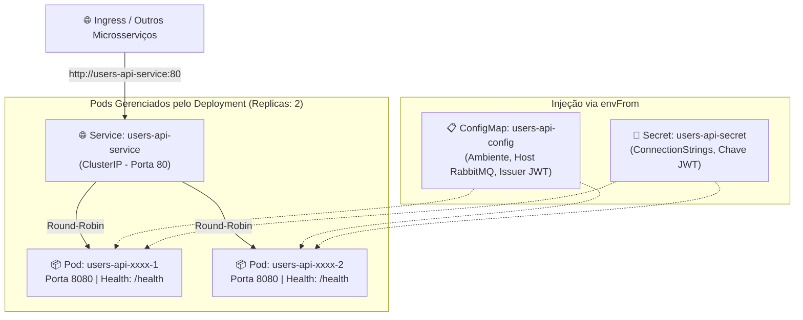

# UsersAPI - Documentação Técnica: Orquestração com Kubernetes (K8s)

Este documento detalha a arquitetura de orquestração em nuvem da **UsersAPI** (`fcg-fase-02--users`) em clusters **Kubernetes (K8s)**, atendendo aos padrões de governança, alta disponibilidade e segregação de credenciais da Fase 02.

---

## 📑 Sumário

- [1. Visão Geral da Topologia no Cluster](#1-visão-geral-da-topologia-no-cluster)
- [2. Estrutura de Manifestos (`/k8s`)](#2-estrutura-de-manifestos-k8s)
- [3. Segregação de Configurações: ConfigMap vs Secret](#3-segregação-de-configurações-configmap-vs-secret)
  - [3.1. `ConfigMap` (Configurações Não Sensíveis)](#31-configmap-configurações-não-sensíveis)
  - [3.2. `Secret` (Credenciais em Base64)](#32-secret-credenciais-em-base64)
- [4. Especificação do `Deployment`](#4-especificação-do-deployment)
  - [4.1. Réplicas e Alta Disponibilidade](#41-réplicas-e-alta-disponibilidade)
  - [4.2. Injeção de Variáveis via `envFrom`](#42-injeção-de-variáveis-via-envfrom)
  - [4.3. Sondas de Integridade (Readiness e Liveness Probes)](#43-sondas-de-integridade-readiness-e-liveness-probes)
  - [4.4. Limites e Requisições de Recursos (Resources)](#44-limites-e-requisições-de-recursos-resources)
- [5. Exposição de Rede com `Service` (ClusterIP)](#5-exposição-de-rede-com-service-clusterip)
- [6. Comandos Essenciais de Operação (`kubectl`)](#6-comandos-essenciais-de-operação-kubectl)
- [7. Navegação](#7-navegação)

---

## 1. Visão Geral da Topologia no Cluster

A UsersAPI no Kubernetes opera como um serviço desacoplado e escalável horizontalmente:



---

## 2. Estrutura de Manifestos (`/k8s`)

Todos os manifestos residem na pasta `/k8s` na raiz do projeto:

| Arquivo | Kind (Tipo) | Responsabilidade |
|---|---|---|
| **`01-configmap.yaml`** | `ConfigMap` | Armazena variáveis de ambiente públicas e nomes DNS do cluster |
| **`02-secret.yaml`** | `Secret` | Armazena dados confidenciais codificados em Base64 |
| **`03-deployment.yaml`** | `Deployment` | Controla o ciclo de vida dos Pods, réplicas, probes e recursos |
| **`04-service.yaml`** | `Service` | Cria um endpoint estável (ClusterIP) para balanceamento interno |

---

## 3. Segregação de Configurações: ConfigMap vs Secret

O ecossistema utiliza a convenção do ASP.NET Core onde as seções aninhadas de configuração são representadas por duplo sublinhado (`__`):

### 3.1. `ConfigMap` (Configurações Não Sensíveis)
- `ASPNETCORE_ENVIRONMENT`: `"Production"`
- `RabbitMQ__HostName`: `"rabbitmq-service"` (aponta para o Service do broker no cluster K8s)
- `RabbitMQ__Port`: `"5672"`
- `RabbitMQ__UserName`: `"guest"`
- `RabbitMQ__Exchange`: `"fcg.users.events"`
- `Jwt__Issuer`: `"FCG02.UsersAPI"`
- `Jwt__Audience`: `"FCG02.CloudGamesClients"`
- `Jwt__ExpirationInSeconds`: `"7200"`

### 3.2. `Secret` (Credenciais em Base64)
- `ConnectionStrings__DefaultConnection`: String de conexão com o Azure Database (banco `fcg-02-usersdb`) em Base64.
- `RabbitMQ__Password`: Senha do usuário do broker em Base64.
- `Jwt__SecretKey`: Chave simétrica HMAC-SHA256 em Base64.

---

## 4. Especificação do `Deployment`

### 4.1. Réplicas e Alta Disponibilidade
O deployment define `spec.replicas: 2`. Em caso de falha de hardware em um nó do cluster ou falha crítica em um contêiner, o outro Pod continua atendendo requisições sem indisponibilidade.

### 4.2. Injeção de Variáveis via `envFrom`
O Deployment utiliza `envFrom` apontando para o ConfigMap e Secret:
```yaml
envFrom:
  - configMapRef:
      name: users-api-config
  - secretRef:
      name: users-api-secret
```
Isso simplifica a governança, evitando o mapeamento manual de dezenas de chaves.

### 4.3. Sondas de Integridade (Readiness e Liveness Probes)
As sondas monitoram o endpoint nativo `/health` da aplicação:
- **`readinessProbe`:** Aguarda 5 segundos (`initialDelaySeconds: 5`) e verifica a cada 10 segundos. O Kubernetes só envia tráfego para o Pod se `/health` retornar HTTP `200 OK`.
- **`livenessProbe`:** Aguarda 15 segundos e verifica a cada 20 segundos. Se o processo travar e falhar 3 vezes consecutivas (`failureThreshold: 3`), o K8s reinicia o contêiner automaticamente.

### 4.4. Limites e Requisições de Recursos (Resources)
- **`requests` (Garantia mínima):** `100m` de CPU (0.1 core) e `128Mi` de RAM.
- **`limits` (Teto máximo):** `300m` de CPU e `256Mi` de RAM para evitar que um Pod com vazamento de memória afete os demais nós do cluster.

---

## 5. Exposição de Rede com `Service` (ClusterIP)

- **Tipo:** `ClusterIP` (endereçamento privado interno).
- **Porta Externa do Serviço:** `80`.
- **Porta Alvo do Contêiner (`targetPort`):** `8080`.
- **DNS Interno:** Qualquer outro Pod do cluster pode se comunicar com a UsersAPI através da URL:
  ```text
  http://users-api-service:80
  ```

---

## 6. Comandos Essenciais de Operação (`kubectl`)

```powershell
# Aplicar todos os manifestos
kubectl apply -f k8s/

# Listar status dos Pods da UsersAPI
kubectl get pods -l app=users-api

# Inspecionar detalhes de um Pod
kubectl describe pod <NOME_DO_POD>

# Visualizar logs em tempo real
kubectl logs -f -l app=users-api

# Acesso de depuração local (Port-Forward)
kubectl port-forward svc/users-api-service 8080:80
```

---

## 7. Navegação

- ⬅️ **[Voltar para a Containerização Docker (`docker.md`)](docker.md)**
- 📑 **[Voltar para o Índice da Documentação (`index.md`)](index.md)**
