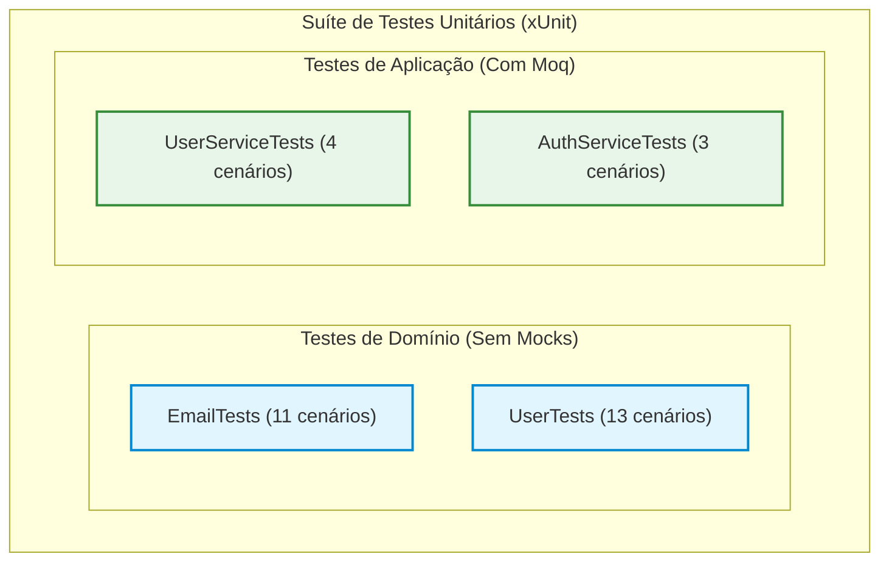

# UsersAPI - Documentação Técnica: Suíte de Testes Unitários

A suíte de testes unitários em **`tests/FCG02.UsersAPI.UnitTests`** é construída com **xUnit** e **Moq**, garantindo que as regras de negócio de Domínio e os casos de uso de Aplicação funcionem de forma determinística, rápida e livre de regressões.

---

## 📑 Sumário

- [1. Visão Geral e Pirâmide de Testes](#1-visão-geral-e-pirâmide-de-testes)
- [2. Padrão AAA (Arrange, Act, Assert) & Boas Práticas](#2-padrão-aaa-arrange-act-assert--boas-práticas)
- [3. Testes da Camada de Domínio (POCOs Puros)](#3-testes-da-camada-de-domínio-pocos-puros)
  - [3.1. `EmailTests`: Validações e Igualdade Estrutural](#31-emailtests-validações-e-igualdade-estrutural)
  - [3.2. `UserTests`: Invariantes da Entidade Rica](#32-usertests-invariantes-da-entidade-rica)
- [4. Testes da Camada de Aplicação (Mocks com Moq)](#4-testes-da-camada-de-aplicação-mocks-com-moq)
  - [4.1. `UserServiceTests`: Isolamento de Repositório e Mensageria](#41-userservicetests-isolamento-de-repositório-e-mensageria)
  - [4.2. `AuthServiceTests`: Validação de Credenciais e Emissão de Tokens](#42-authservicetests-validação-de-credenciais-e-emissão-de-tokens)
- [5. Execução dos Testes via .NET CLI](#5-execução-dos-testes-via-net-cli)
- [6. Navegação](#6-navegação)

---

## 1. Visão Geral e Pirâmide de Testes

Os testes unitários focam na base da pirâmide de testes: **execução ultrarrápida (milissegundos)**, sem conexão de rede e sem dependência de containers PostgreSQL ou RabbitMQ ativos.



---

## 2. Padrão AAA (Arrange, Act, Assert) & Boas Práticas

Todos os testes seguem a estrutura rigorosa em três seções:
1. **Arrange:** Configuração das variáveis, instâncias de entrada e comportamentos esperados dos mocks.
2. **Act:** Invocação do método sob teste.
3. **Assert:** Verificação de que o resultado retornado ou a exceção lançada é exatamente a esperada.

### Convenção de Nomenclatura:
`[MetodoSobTeste]_[CenarioOuCondicao]_[ResultadoEsperado]`  
*Exemplo: `RegisterAsync_WithExistingEmail_ShouldThrowInvalidOperationException`*

---

## 3. Testes da Camada de Domínio (POCOs Puros)

### 3.1. `EmailTests`: Validações e Igualdade Estrutural

Localização: `tests/FCG02.UsersAPI.UnitTests/Domain/ValueObjects/EmailTests.cs`

Utiliza **`[Theory]`** com **`[InlineData]`** para testar dezenas de variações de entradas válidas e inválidas:

```csharp
public class EmailTests
{
    [Theory]
    [InlineData("gamer@fiap.com.br")]
    [InlineData("admin.user@cloudgames.io")]
    [InlineData("test+tag@sub.domain.org")]
    public void Constructor_WithValidEmail_ShouldCreateInstanceAndNormalize(string input)
    {
        var email = new Email(input);
        Assert.Equal(input.Trim().ToLowerInvariant(), email.Value);
    }

    [Theory]
    [InlineData("")]
    [InlineData("   ")]
    [InlineData(null)]
    public void Constructor_WithNullOrWhitespace_ShouldThrowArgumentException(string? invalidInput)
    {
        Assert.Throws<ArgumentException>(() => new Email(invalidInput!));
    }

    [Theory]
    [InlineData("invalid-email")]
    [InlineData("user@")]
    [InlineData("@domain.com")]
    [InlineData("user@domain")]
    public void Constructor_WithInvalidFormat_ShouldThrowArgumentException(string invalidEmail)
    {
        Assert.Throws<ArgumentException>(() => new Email(invalidEmail));
    }

    [Fact]
    public void Equals_WithSameValuesDifferentCasingOrSpacing_ShouldBeEqual()
    {
        var email1 = new Email("contato@fiap.com.br");
        var email2 = new Email("CONTATO@fiap.com.br ");

        Assert.Equal(email1, email2);
        Assert.True(email1 == email2);
    }
}
```

---

### 3.2. `UserTests`: Invariantes da Entidade Rica

Localização: `tests/FCG02.UsersAPI.UnitTests/Domain/Entities/UserTests.cs`

Garante que um `User` nunca seja instanciado em estado inválido e que suas operações de mutação registrem `UpdatedAt`:

```csharp
public class UserTests
{
    private readonly Email _validEmail = new("gamer@fiap.com.br");

    [Fact]
    public void Constructor_WithValidParameters_ShouldInstantiateUserSuccessfully()
    {
        var user = new User("Gamer", _validEmail, "$2a$11$hash...", UserRole.Gamer);

        Assert.NotEqual(Guid.Empty, user.Id);
        Assert.Equal("Gamer", user.Name);
        Assert.Equal(_validEmail, user.Email);
        Assert.Equal(UserRole.Gamer, user.Role);
        Assert.Null(user.UpdatedAt);
    }

    [Theory]
    [InlineData("")]
    [InlineData("   ")]
    [InlineData(null)]
    public void Constructor_WithNullOrEmptyName_ShouldThrowArgumentException(string? invalidName)
    {
        Assert.Throws<ArgumentException>(() => 
            new User(invalidName!, _validEmail, "$2a$11$hash...", UserRole.Gamer));
    }

    [Fact]
    public void UpdateProfile_WithValidName_ShouldUpdateNameAndSetUpdatedAt()
    {
        var user = new User("Gamer", _validEmail, "$2a$11$hash...", UserRole.Gamer);
        user.UpdateProfile("Novo Nome");

        Assert.Equal("Novo Nome", user.Name);
        Assert.NotNull(user.UpdatedAt);
    }
}
```

---

## 4. Testes da Camada de Aplicação (Mocks com Moq)

### 4.1. `UserServiceTests`: Isolamento de Repositório e Mensageria

Localização: `tests/FCG02.UsersAPI.UnitTests/Application/Services/UserServiceTests.cs`

Verifica a orquestração do caso de uso de registro de usuário, garantindo que o evento só é publicado se a gravação no banco for bem-sucedida:

```csharp
public class UserServiceTests
{
    private readonly Mock<IUserRepository> _userRepositoryMock = new();
    private readonly Mock<IPasswordHasher> _passwordHasherMock = new();
    private readonly Mock<IEventPublisher> _eventPublisherMock = new();
    private readonly UserService _userService;

    public UserServiceTests()
    {
        _userService = new UserService(
            _userRepositoryMock.Object,
            _passwordHasherMock.Object,
            _eventPublisherMock.Object);
    }

    [Fact]
    public async Task RegisterAsync_WithValidRequest_ShouldCreateUserAndPublishEvent()
    {
        // Arrange
        var request = new RegisterUserRequest("Gamer Pro", "gamer.pro@fiap.com.br", "Senha123!");
        _userRepositoryMock.Setup(r => r.ExistsByEmailAsync(It.IsAny<string>(), It.IsAny<CancellationToken>()))
                           .ReturnsAsync(false);
        _passwordHasherMock.Setup(h => h.HashPassword(request.Password))
                           .Returns("$2a$11$hash...");

        // Act
        var response = await _userService.RegisterAsync(request);

        // Assert
        Assert.NotNull(response);
        _userRepositoryMock.Verify(r => r.AddAsync(It.IsAny<User>(), It.IsAny<CancellationToken>()), Times.Once);
        _eventPublisherMock.Verify(p => p.PublishAsync(It.IsAny<UserCreatedEvent>(), It.IsAny<CancellationToken>()), Times.Once);
    }

    [Fact]
    public async Task RegisterAsync_WithExistingEmail_ShouldThrowInvalidOperationException()
    {
        // Arrange
        var request = new RegisterUserRequest("Gamer Pro", "gamer.pro@fiap.com.br", "Senha123!");
        _userRepositoryMock.Setup(r => r.ExistsByEmailAsync(It.IsAny<string>(), It.IsAny<CancellationToken>()))
                           .ReturnsAsync(true);

        // Act & Assert
        await Assert.ThrowsAsync<InvalidOperationException>(() => _userService.RegisterAsync(request));

        // Garante que o usuário NÃO foi salvo e nenhum evento foi publicado
        _userRepositoryMock.Verify(r => r.AddAsync(It.IsAny<User>(), It.IsAny<CancellationToken>()), Times.Never);
        _eventPublisherMock.Verify(p => p.PublishAsync(It.IsAny<UserCreatedEvent>(), It.IsAny<CancellationToken>()), Times.Never);
    }
}
```

---

### 4.2. `AuthServiceTests`: Validação de Credenciais e Emissão de Tokens

Localização: `tests/FCG02.UsersAPI.UnitTests/Application/Services/AuthServiceTests.cs`

Valida que apenas credenciais corretas geram tokens JWT:

```csharp
public class AuthServiceTests
{
    private readonly Mock<IUserRepository> _userRepositoryMock = new();
    private readonly Mock<IPasswordHasher> _passwordHasherMock = new();
    private readonly Mock<ITokenService> _tokenServiceMock = new();
    private readonly AuthService _authService;

    public AuthServiceTests()
    {
        _authService = new AuthService(
            _userRepositoryMock.Object,
            _passwordHasherMock.Object,
            _tokenServiceMock.Object);
    }

    [Fact]
    public async Task LoginAsync_WithValidCredentials_ShouldReturnAuthResponse()
    {
        var email = "gamer@fiap.com.br";
        var user = new User("Gamer", new Email(email), "$2a$11$hash...", UserRole.Gamer);

        _userRepositoryMock.Setup(r => r.GetByEmailAsync(email, It.IsAny<CancellationToken>()))
                           .ReturnsAsync(user);
        _passwordHasherMock.Setup(h => h.VerifyPassword("Senha123!", user.PasswordHash))
                           .Returns(true);
        _tokenServiceMock.Setup(t => t.GenerateToken(user))
                         .Returns("jwt.valido.aqui");

        var response = await _authService.LoginAsync(new LoginRequest(email, "Senha123!"));

        Assert.NotNull(response);
        Assert.Equal("jwt.valido.aqui", response.AccessToken);
    }

    [Fact]
    public async Task LoginAsync_WithNonExistentEmail_ShouldThrowUnauthorizedAccessException()
    {
        _userRepositoryMock.Setup(r => r.GetByEmailAsync(It.IsAny<string>(), It.IsAny<CancellationToken>()))
                           .ReturnsAsync((User?)null);

        await Assert.ThrowsAsync<UnauthorizedAccessException>(() => 
            _authService.LoginAsync(new LoginRequest("naoexiste@fiap.com.br", "123456")));
    }
}
```

---

## 5. Execução dos Testes via .NET CLI

Para executar toda a suíte com relatório detalhado:

```powershell
dotnet test tests/FCG02.UsersAPI.UnitTests/FCG02.UsersAPI.UnitTests.csproj --logger "console;verbosity=detailed"
```

---

## 6. Navegação

- ⬅️ **[Voltar para a Camada de Apresentação (`api.md`)](api.md)**
- ➡️ **[Avançar para Containerização e Docker (`docker.md`)](docker.md)**
- 🏠 **[Voltar para o Índice da Documentação](index.md)**
